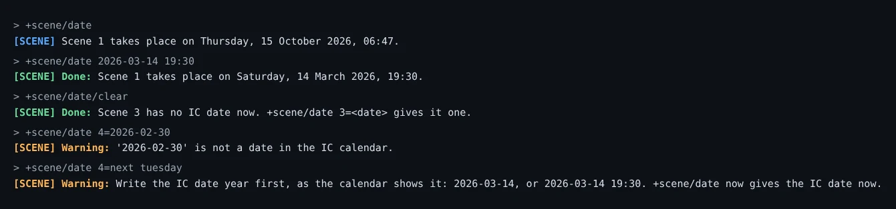
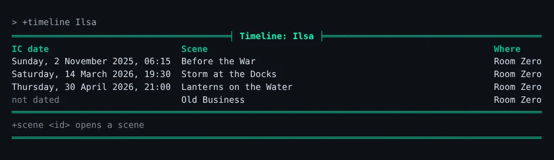
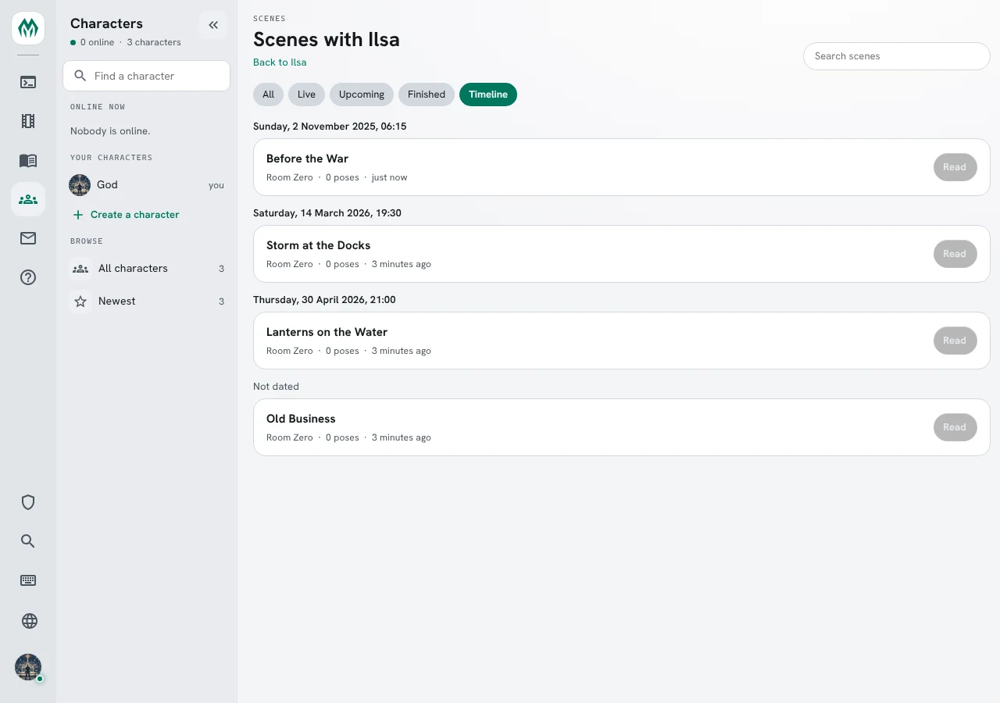
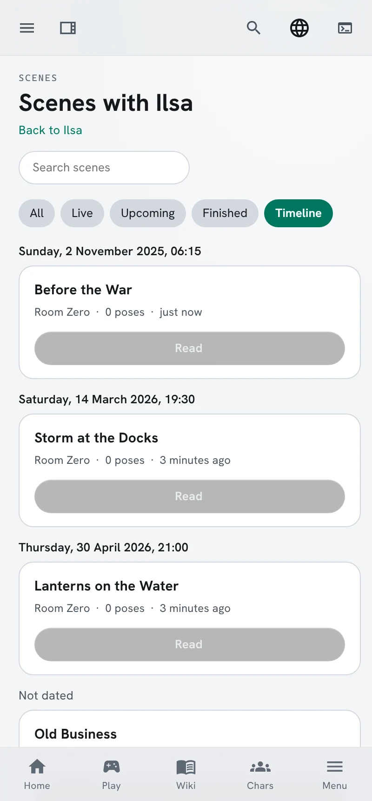

import { Aside } from '@astrojs/starlight/components';

The **timeline** package puts every scene on the game's IC calendar and lists each character's
scenes in story order:

- A scene gets the IC date when it starts.
- `+scene/date` gives a flashback the date it really happens on.
- `+timeline` lists a character's finished scenes in IC order, earliest first.
- The portal shows the same list on a character's scenes page, under **Timeline**.

It needs the Scene plugin, the `scene` package and the `time` package, whose Clock keeps the IC
calendar. See [Time and Time Zones](/guides/time/#the-ic-date) for setting the calendar up.

| You are | You want to | Read |
|---|---|---|
| A player | see when a scene takes place | [A scene's IC date](#a-scenes-ic-date) |
| A player | date a flashback | [Dating a scene](#dating-a-scene) |
| A player | see a character's story in order | [The timeline](#the-timeline) |
| Staff | install it, or stop scenes being dated on their own | [Installing and settings](#installing-and-settings) |
| A coder | read IC dates in your own code | [For coders](#for-coders) |

In the game, `+help timeline` and `+help scene date` have the same commands in short form.

## A scene's IC date

When a scene starts, it takes the IC date the Clock shows at that moment. Pausing and resuming a
scene keeps the date it had.

`+scene/date` shows the date of the scene you are in, and `+scene/date <id>` the date of any scene
you can see:

```text
> +scene/date 1
[SCENE] Scene 1 takes place on Saturday, 14 March 2026, 19:30.
```

The date is a scene detail, so it shows with the others in `+scene <id>`:

```text
> +scene 1
========================< Scene 1: Storm at the Docks >=======================
Status:    finished
Owner:     Ilsa
Where:     Room Zero
Created:   Oct 15 06:47AM
Scheduled: -
Watchers:  Anyone
===================================< Pitch >==================================
-
==================================< Details >=================================
IC date  Saturday, 14 March 2026, 19:30
==================================< Players >=================================
Status  Name                                                             Poses
Owner   Ilsa                                                                 0
==============================================================================
```

The portal shows it on the scene's page, as it does every [scene detail](/guides/scene-details/).

## Dating a scene

A scene's owner, or staff, can change its date. Write the date year first, as the IC calendar shows
it, with an optional time:

- `+scene/date <date>` dates the scene you are in.
- `+scene/date <id>=<date>` dates any scene you own.
- `+scene/date/clear [<id>]` takes the date off.

`2026-03-14` is midnight on that day; `2026-03-14 19:30` adds the time. `now` is the IC date now.

```text
> +scene/date 2026-03-14 19:30
[SCENE] Done: Scene 1 takes place on Saturday, 14 March 2026, 19:30.
> +scene/date/clear
[SCENE] Done: Scene 3 has no IC date now. +scene/date 3=<date> gives it one.
```

A date the calendar does not have, or one written another way, is refused:

```text
> +scene/date 4=2026-02-30
[SCENE] Warning: '2026-02-30' is not a date in the IC calendar.
> +scene/date 4=next tuesday
[SCENE] Warning: Write the IC date year first, as the calendar shows it: 2026-03-14, or 2026-03-14 19:30. +scene/date now gives the IC date now.
```



The year is the IC year. A game whose calendar is set 300 years ahead writes `2326-03-14`, and the
scene is placed by that date.

### Words instead of a date

`+scene/set icdate=<words>` changes only the words a scene shows, such as `The night of the storm`.
The scene keeps its place on the timeline, so a vague date still sorts where it happens:

```text
> +scene/set 2/icdate=The night of the storm
[SCENE] Done: Scene 2: IC date is now The night of the storm.
```

`+scene/date` writes both the words and the place again.

## The timeline

`+timeline` lists your finished scenes in IC order, earliest first. `+timeline <name>` lists
another character's: only the scenes you can see, so a private scene shows only to the people in it.

```text
> +timeline Ilsa
==============================< Timeline: Ilsa >==============================
IC date                         Scene                                Where
Sunday, 2 November 2025, 06:15  Before the War                       Room Zero
Saturday, 14 March 2026, 19:30  Storm at the Docks                   Room Zero
Thursday, 30 April 2026, 21:00  Lanterns on the Water                Room Zero
not dated                       Old Business                         Room Zero
==============================================================================
+scene <id> opens a scene
==============================================================================
```

*Before the War* was played after *Storm at the Docks*, and comes first because it is dated earlier.
Scenes with no date come last, marked `not dated`.

A page holds as many scenes as fit your screen. `+timeline/2 [<name>]` shows the second page, and
each page but the last ends with the command for the next. Past the last page:

```text
> +timeline/3 Ilsa
[TIMELINE] Warning: There is one page - you asked for page 3.
```



### In the portal

A character's scenes page, **Scenes with &lt;name&gt;**, gains a **Timeline** chip when the timeline
package is installed. It lists the same finished scenes in the same order, each under its IC date:



The search box narrows the timeline too. On a phone the dates sit above full-width cards:



## Installing and settings

The timeline package ships with the server but is not installed at first boot. Install it from the
portal's **Packages** page, or tick it in the setup wizard. It needs `scene` 1.6 or later, `time` 1.1
or later and the event handler chosen in first-run setup, and installs only while the Scene plugin
runs. Its `+help` topics and `+config` settings come with it, through the `timeline-help` and `timeline-config` bridges, wherever `+help` and `+config` are installed.

Scenes played before it was installed have no date. They show as `not dated` until their owners date
them.

`+config timeline` shows its one setting:

```text
> +config timeline
+===========================< Settings: timeline >===========================+
| IC dates on scenes and the +timeline list.                                 |
|                                                                            |
| Setting  Value  Allowed    What it does                                    |
| -------------------------------------------------------------------------- |
| stamp    yes    Yes or no  Give a scene the IC date when it starts, unless |
|                            it has one.                                     |
+============================================================================+
| +config timeline/<setting>=<value> changes one.                            |
+============================================================================+
```

Turn `stamp` off when your game's scenes rarely happen "now", so each owner dates their own:

```text
> +config timeline/stamp=no
[CONFIG] Done: timeline/stamp is now no, was yes.
```

How the date is written, the months' and weekdays' names, and the year the calendar adds are the
time package's settings: `+config time`. A change to how dates are written applies to dates given
after it; dates already given keep their words.

## For coders

A scene's date is two [scene details](/guides/scene-details/):

| Detail | Holds |
|---|---|
| `icdate` | The words shown, as the Clock writes the date |
| `icsecs` | The IC moment in seconds, before the calendar's years are added; hidden, and what the timeline sorts by |

```text
> think scene(1,icsecs)
1773516600
> think scenedetail(icdate,sort)
icsecs
> think scenedetail(icsecs,hidden)
1
```

`icdate` names `icsecs` as its `sort`, so the portal and `api/scenes?sort=icdate` order scenes by
the number while showing the words. `icsecs` is `hidden`: it never shows in `+scene`, on a card, or in
a search. Any package can use the same two fields for a detail of its own; see
[Listing details](/guides/scene-details/#listing-details).

`scenelist(mine,<player>)` lists another player's scenes that you can see, as the timeline does.

### Acting when a scene starts

The package dates a scene by hearing the `` SCENE`STATUS `` event, which the Scene plugin raises
when a scene is made or its status changes. `%<scene>` is the scene's id, `%<status>` its status now
and `%<previous>` the one before, empty for a new scene. The package's attribute on the Event Handler:

```yaml
- ref: event
  target: "{{$event_handler}}"
  attributes:
    SCENE`STATUS`TIMELINE: |-
      @assert strmatch(%<status>,active); @trigger {{timeline}}/TRIG`STAMP=%<scene>
```

<Aside>
A scene starts active when it is made, and becomes active again when it resumes from a pause, so the
event fires for both. The timeline package keeps a date a scene already has.
</Aside>

See [Events](/guides/events/) for hearing events from your own package.
