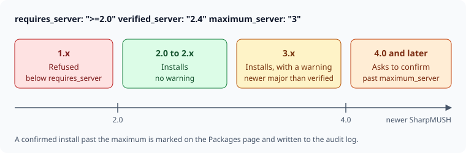
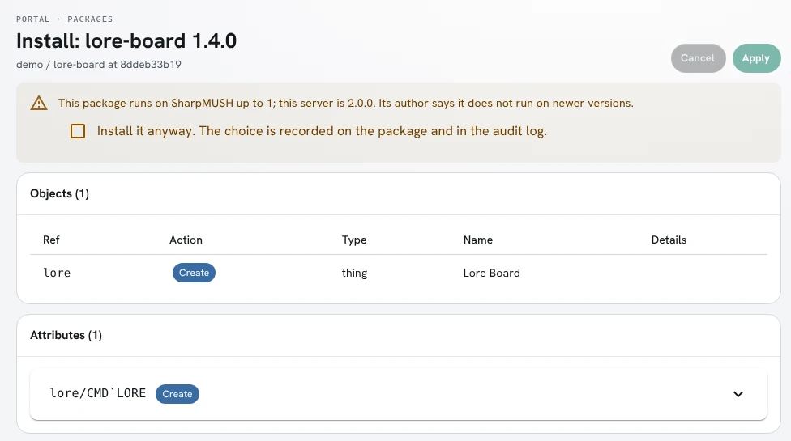
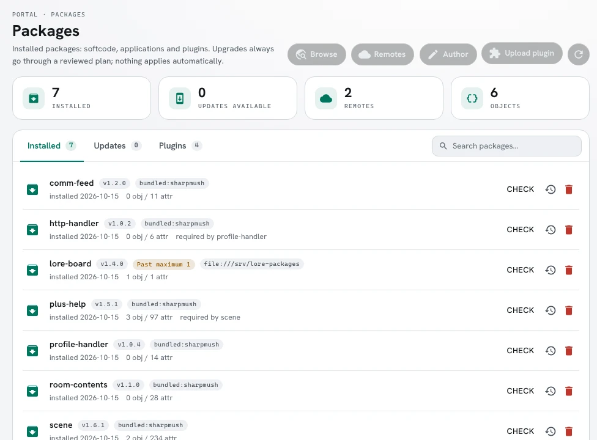
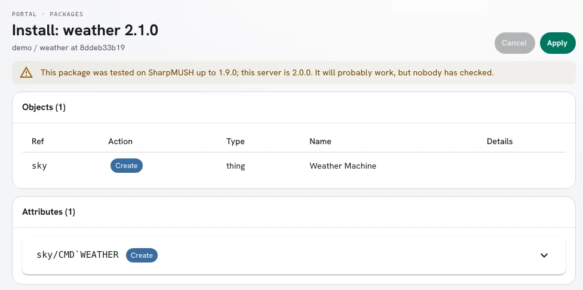

import { Aside } from '@astrojs/starlight/components';

A version number is a promise to the people who install your package. When they see `1.4.0` become
`1.5.0`, they expect to upgrade without fixing anything. When they see `2.0.0`, they expect to read
what changed first. SharpMUSH versions itself the same way, so a package can say which SharpMUSH
versions it runs on, and an administrator sees a warning before an install rather than a broken
command after it.

This page covers:

- [Major, minor and patch](#major-minor-and-patch)
- [What counts as breaking in a package](#what-counts-as-breaking-in-a-package)
- [What counts as breaking in SharpMUSH](#what-counts-as-breaking-in-sharpmush)
- [Stating the SharpMUSH versions a package runs on](#stating-the-sharpmush-versions-a-package-runs-on)
- [When to set a maximum](#when-to-set-a-maximum)
- [Ranges on dependencies](#ranges-on-dependencies)
- [Before you release](#before-you-release)

## Major, minor and patch

A version is three numbers, `MAJOR.MINOR.PATCH`. Every release of a package raises one of them; a
package that changes and keeps its version cannot be told apart from the one it replaced.

| Raise | When the release | Example |
|---|---|---|
| **Major** (`1.4.2` to `2.0.0`) | can break a game that used the previous version | `+bbread` takes the board name before the number |
| **Minor** (`1.4.2` to `1.5.0`) | adds something, and everything that worked still works | a new `+bbsearch` command |
| **Patch** (`1.4.2` to `1.4.3`) | fixes or speeds something up, and adds nothing | a typo in a message, a faster `+bbscan` |

Raising one number resets the ones after it: `1.4.2` becomes `1.5.0` or `2.0.0`, never `1.5.2`.
A prerelease such as `2.0.0-beta.1` sorts before `2.0.0` and is installed only by an administrator
who asks for it.

## What counts as breaking in a package

A change is breaking when a player, a builder, or another package has to change something to keep
working. In a softcode package that is:

- removing or renaming a command, or a switch of one;
- changing what a command's arguments mean, or their order;
- removing or renaming an attribute that other code is told to call or set, such as a `FN` function
  other packages `u()`, or a `FILTER` extension point;
- changing a function's arguments or what it returns, when other code calls it;
- removing an object that another package refers to as `{{your-package/ref}}`;
- removing a role, permission or configuration option the package declared, when the game may rely
  on it;
- storing data in a new shape that the previous version's attributes no longer read;
- raising `requires_server` to a new SharpMUSH major version.

These are not breaking: a new command, switch or option with a default that keeps today's
behaviour; new attributes; different wording in messages, unless your package documents its output
as something to parse; a bug fix, even one a game had come to depend on (say so in the release
notes).

## What counts as breaking in SharpMUSH

SharpMUSH follows the same rules, seen from the packages that run on it.

- A **major** release may remove or rename a command, function, switch or substitution, change the
  order or meaning of a function's arguments, or change output that softcode reads, such as what a
  function returns. Each one is listed in the release notes.
- A **minor** release adds commands, functions, switches, configuration options and package format
  keys. Anything that ran on `2.3` runs on `2.4`.
- A **patch** release fixes bugs.

`version()` reports the version a game is running, and the portal shows it on the **Server** page.

## Stating the SharpMUSH versions a package runs on

Three keys in `package.yaml` place a package against SharpMUSH's versions. The last two need
`format: 1.6`.

```yaml
format: 1.6
package: lore-board
version: 1.4.0
requires_server: ">=2.0"    # the lowest version it runs on
verified_server: "2.4"      # the newest version you tested it on
maximum_server: "3"         # leave out unless you know a newer version breaks it
```

- **`requires_server`** is the lowest version, written with `>=`. A server below it refuses the
  package. Raise it when the package starts using a command or function that version added.
- **`verified_server`** is the newest version you tested on. Update it whenever you test on a new
  release. When a game runs a newer *major* version, the review screen warns that nobody has tested
  the package there, and the install goes ahead.
- **`maximum_server`** is the newest version the package runs on. What you leave out matches
  anything: `3` covers every 3.x, `3.2` every 3.2.x. On a newer server the review screen warns, and
  the administrator must tick **Install it anyway** before **Apply** turns on.



This is what the review screen shows for a package whose `maximum_server` is `1`, on a 2.0.0 server:



Once confirmed, the package carries a **Past maximum** mark on the Packages page, and the audit log
records a `package.past-maximum` entry with the version and the server it went onto. Installing a
version whose range fits the server clears the mark.



A package whose `verified_server` is older gets a warning and nothing to confirm:



## When to set a maximum

Set `maximum_server` only when you know a SharpMUSH version breaks the package: the release notes
for SharpMUSH 3.0 remove a function you call, and you have not released a version that copes.

<Aside type="caution">
Don't set a maximum to be safe. A maximum on every package makes every SharpMUSH upgrade warn about
packages that still work, and administrators learn to tick the box without reading it. Then the
one warning that matters goes unread too. `verified_server` already tells them what you tested.
</Aside>

When a break does come, a typical sequence is:

1. SharpMUSH 3.0 is announced, removing a function `lore-board` 1.4.0 calls.
2. You release `lore-board` 1.4.1 with `maximum_server: "2"`, so games on 3.0 are asked before
   installing it.
3. You release `lore-board` 2.0.0, which works on 3.0, with `requires_server: ">=3.0"` and no
   maximum.

## Ranges on dependencies

The same rule applies to the packages yours depends on. Write the lowest version that has what you
use, and no upper bound:

```yaml
depends:
  - plus-help: ">=1.2"          # not ">=1.2 <2.0"
```

`plus-help` 2.0 might break nothing you use. If a dependency's major release does break your
package, add the bound then (`">=1.2 <2.0"`), in a release of your own. Unlike `maximum_server`, an
unmet dependency range refuses the install with nothing to confirm: once a game has `plus-help` 2.0,
a guessed `<2.0` keeps your package off it even if it would have worked.

## Before you release

- [ ] Raise `version` by the rule above, even for a one-line fix.
- [ ] If you raised the major version, list what broke in the README or release notes.
- [ ] Raise `requires_server` if you use something a newer SharpMUSH added.
- [ ] Set `verified_server` to the newest SharpMUSH you tested on.
- [ ] Leave `maximum_server` and dependency upper bounds out unless a break is known.
- [ ] Run `SharpMUSH.PackageTool` (or the portal's package author page) to check the manifest.

The [Package Declarations](/reference/package-declarations#engine-version-range-format-16) reference lists the
keys and the errors the server reports for a malformed range.
