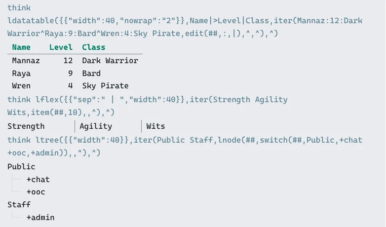

import SharpieIllustration from '../../../components/SharpieIllustration.astro';
import { Aside, Card, CardGrid, LinkCard, Steps } from '@astrojs/starlight/components';

SharpMUSH softcode can describe a display once and let each reader receive the form that works for
them. A terminal gets carefully aligned text and box-drawing characters. The web portal gets
responsive page structure and real images. A screen reader gets the same information in reading
order, without decorative borders getting in the way.

<SharpieIllustration scene="appearance" />

That makes layouts useful for more than decoration: they give a game a recognisable visual language
while keeping the content adaptable.

## Build from layout primitives

<CardGrid>
  <Card title="Structure" icon="setting">
    `box()` and `rule()` create titled boundaries. `flex()` and `item()` place related sections
    together and stack them when space is tight.
  </Card>
  <Card title="Information" icon="open-book">
    `fields()`, `tree()`, `bullets()`, `grid()`, `datatable()`, and `datacolumns()` express the
    meaning of a display instead of baking it into spaces.
  </Card>
  <Card title="Status" icon="information">
    `gauge()`, `badge()`, and `gradient()` add visible state while retaining text and numeric meaning.
  </Card>
  <Card title="Images" icon="puzzle">
    `image()` sends a picture with a description. `figure()` pairs that picture with terminal art,
    surrounding content, and an accessible description.
  </Card>
</CardGrid>

Layouts can nest. A `fields()` or `flex()` on a line of its own inside `box()` becomes structured
content inside that box; a `rule()` becomes a real divider. Use an empty width or `auto` to draw for
each reader's reported width rather than assuming an 80-column terminal.

### Example: a character sheet

```sharp
think box(fields({{"cols":2}},Name,Mannaz Byron,Species,Human,Calling,Dark Warrior,Status,Ready),Character,60,{{"theme":"fantasy","border":"rounded"}})
```

A Unicode terminal receives a rounded, themed character card. A client without Unicode receives an
ASCII border. In the portal, the fields become responsive page structure. For a screen reader, the
border disappears and the content is read as `Name: Mannaz Byron`, `Species: Human`, and so on.

### Example: a row for each record

`datatable()`, `flex()`, `tree()` and `node()` take one argument per row, item or child. When the
code only learns how many there are as it runs, use the list form: `ldatatable()`, `lflex()`,
`ltree()` or `lnode()` take them as one list and a delimiter, so a single `iter()` builds the whole
display.

```sharp
think ldatatable({{"width":40,"nowrap":"2"}},Name|>Level|Class,iter(Mannaz:12:Dark Warrior^Raya:9:Bard^Wren:4:Sky Pirate,edit(##,:,|),^,^),^)
```

```text
Name    Level  Class
---------------------------
Mannaz     12  Dark Warrior
Raya        9  Bard
Wren        4  Sky Pirate
```

In the web portal the table, the row from `lflex()` and the tree from `ltree()` are page structure:



The cells of each row are still split by `|`; the rows are split by `^`, the last argument. Pick a
row delimiter that never appears in the content. A list of layouts, such as nodes for `ltree()`,
needs one that never appears in their drawn text either: borders and tree guides contain `|` and
spaces. A marked delimiter, as in the next example, can't collide with either.

### Example: delimiters for text a player typed

Any delimiter you pick by hand can turn up in what a player types. A motto of `Dark|Light` splits
into two cells. Mark the delimiter instead: `%*<|>` is a `|` that list and layout functions split
on only where it is marked, so a `|` a player typed stays inside its cell.

```sharp
&MOTTO`MANNAZ me=Dark|Light
&MOTTO`RAYA me=Bard^Poet
think ldatatable({{"width":30,"delim":"%*<|>"}},Name%*<|>Motto,iter(lattr(me/MOTTO`*),[after(##,`)]%*<|>[unmark(v(##))],%b,%*<^>),%*<^>)
```

```text
Name    Motto
------------------
MANNAZ  Dark|Light
RAYA    Bard^Poet
```

`%*<|>` separates the cells and `%*<^>` the rows. Write the cell delimiter into the options as it
is; `json()` builds plain text and would drop the mark. A player can type `%*<|>` too, so put text
a player typed through `unmark()` before it goes into a list. It keeps the colour and takes the mark
off. `secure()` and `escape()` take it off as well.

<Aside type="tip" title="Prefer meaning over manual spacing">
If the content is a set of labels and values, use `fields()` rather than padding strings yourself.
When the labels are only known when the code runs, `lfields()` takes them and their values as two lists.
If it is hierarchical, use `tree()`. SharpMUSH can only adapt a display when the structure is
present in the softcode.
</Aside>

## Give the game a visual language

Every layout is drawn in a layout theme: the game's `layout_theme`, a player's own `@theme`, or one a
layout names with its `"theme"` option. A theme controls borders, titles, headings, field labels,
bullets, tree guides, gauges, and the quieter separators between them. Nothing essential should
depend on colour alone: the text, values, and structure remain present. A player's `@theme` changes
layouts sent to MU\* clients; it does not override the portal's own theme.
[Layout Themes](/guides/layout-themes/) covers choosing, adding and inheriting themes.

## Draw pictures without losing the text

`image()` is appropriate for a standalone picture. `figure()` is the richer layout primitive: it
can show a real image in capable clients, text art in a terminal, descriptive text when neither is
available, and content flowing beside it.

```sharp
think box(figure(https://images.example.org/mannaz.png,Mannaz Byron wearing dark armour,/|_/|%r=^.^=%r%b> <,left,fields(,Species,Human,Calling,Dark Warrior)),Mannaz Byron,44)
```

The description is not optional polish. It gives a screen reader the image's meaning and remains
the fallback when a client can show neither the picture nor terminal art. Terminal art is a
presentation fallback, not alternative text; keep the description useful even when the art is
removed.

Markdown images follow the same model:

```markdown

```

Capable clients receive the picture. Text readers receive the description. An image alone in its
paragraph is treated as a figure; an image inside a sentence stays inline.

<Aside type="caution" title="Image delivery is permission- and host-gated">
Images are sent only when the caller may send out-of-band media and the address is allowed by the
game's `image_hosts` policy. `figure()` and rendered Markdown do not bypass those controls. Always
provide a description and a useful text fallback.
</Aside>

## A practical design sequence

<Steps>
1. Identify the information and reading order before choosing colours or borders.
2. Express that structure with `fields()`, `flex()`, `tree()`, tables, or another layout primitive.
3. Wrap related content with `box()` and `rule()` to establish the game's repeated visual language.
4. Apply a game theme, reserving explicit per-layout themes for displays that intentionally differ.
5. Add images with meaningful descriptions and terminal fallbacks.
6. Test a narrow terminal, an ASCII-only client, the portal, and screen-reader mode.
</Steps>

<LinkCard
  title="Complete layout-function reference"
  href="/reference/sharpmush-help/layout-functions/"
  description="Every layout function, border option, theme form, accessibility behavior, and worked example."
/>

<LinkCard
  title="Image and Pueblo functions"
  href="/reference/sharpmush-help/sharppueb/#image"
  description="The image() function, permissions, host policy, and client behavior."
/>
