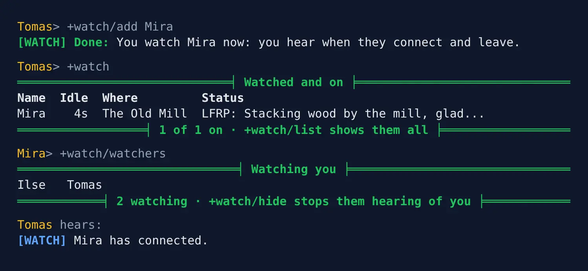
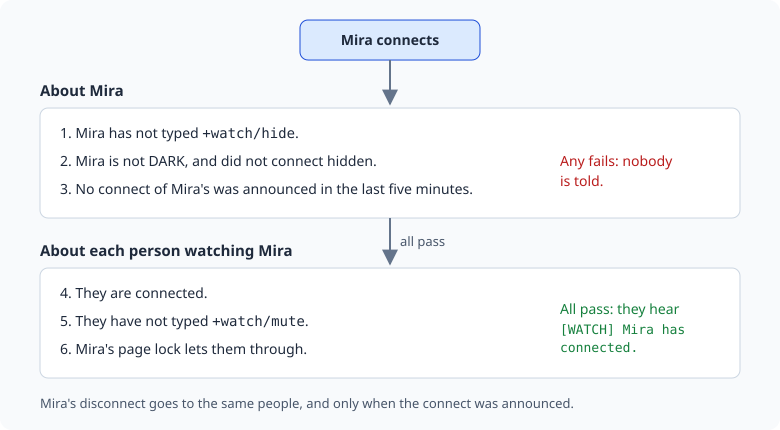

import { Aside } from '@astrojs/starlight/components';

The **watch list** tells you when the people you play with connect and leave, and shows
which of them are on now, where they are, and their status from `+who`.

| You are | You want to | Read |
|---|---|---|
| A player | follow the people you play with | [Watching someone](#watching-someone) |
| A player | keep others from tracking you | [Privacy](#privacy) |
| Staff | install it and change its settings | [Running the watch list](#running-the-watch-list) |

In the game, `+help watch` has the same commands in short form.

## Watching someone

`+watch/add <name>` adds someone to your watch list. From then on you hear when they
connect and when they leave:

```
> +watch/add Mira
[WATCH] Done: You watch Mira now: you hear when they connect and leave.
[WATCH] Mira has connected.
[WATCH] Mira has disconnected.
```

`+watch/del <name>` takes them off again.

- `+watch` lists the people you watch who are on now, with where they are and their status.
- `+watch/list` lists everyone you watch, with when each was last on.

```
> +watch
══════════════════════════════╡ Watched and on ╞══════════════════════════════
Name  Idle  Where         Status
Mira    4s  The Old Mill  LFRP: Stacking wood by the mill, glad...
══════════════════╡ 1 of 1 on · +watch/list shows them all ╞══════════════════
> +watch/list
══════════════════════════════════╡ Watched ╞═════════════════════════════════
Name  Last on
Mira  on now
═════════════════╡ 1 watched · +watch/mute stops the notices ╞════════════════
```

The Status column shows what `+who` shows, from [Status](/guides/status) or any other
package that adds to `+who`.



When you log in, you hear which of the people you watch are already on:

```
[WATCH] On now of those you watch: Mira.
```

`+watch/mute` stops the connect and disconnect lines but keeps your list.
`+watch/unmute` starts them again.

A connection that drops and comes straight back does not announce itself twice. After a
connect is announced, the next one within five minutes is not, and neither is its
disconnect.

### Coming from +watch or +friend

The commands follow the FRIEND global many games already run. `+friend` is the same
command as `+watch`, so `+friend/add`, `+friend/del` and `+friend/delete` work, and so do
`/hide` and `/mute`.

## Privacy

You decide whether others can follow you:

- `+watch/watchers` shows who watches you.
- `+watch/hide` stops anyone hearing when you connect or leave, and leaves you out of
  their `+watch`. `+watch/unhide` undoes it.
- Someone your page lock keeps out is never told when you connect. See `help @lock/page`
  in the game.
- Nobody hears of you while you are DARK or connected hidden.
- Someone who cannot locate you sees `-` where your room would be.

```
> +watch/watchers
═══════════════════════════════╡ Watching you ╞═══════════════════════════════
Ilse   Tomas
════════════╡ 2 watching · +watch/hide stops them hearing of you ╞════════════
> +watch/hide
[WATCH] Done: Nobody hears when you connect or leave, and you are left out of everyone's +watch. +watch/unhide undoes it.
```



## Pages

A list longer than your screen is split into pages. The last line says which page you are
on and how to see the next: add the page number as the last switch.

| Type | To see |
|---|---|
| `+watch/2` | the second page of the people you watch who are on |
| `+watch/list/2` | the second page of everyone you watch |
| `+watch/watchers/2` | the second page of who watches you |

## Running the watch list

### Installing

The watch list ships with the server but is not installed on a new game. An administrator
installs it from the portal:

1. Open **Packages** in the admin area and choose **Browse**.
2. Install `who-where`, which gives `+who` and `+where`.
3. Install `watch`. It needs `who-where`. Its `+help` topics and `+config` settings come with it, through the `watch-help` and `watch-config` bridges, wherever `+help` and `+config` are installed.

It adds the commands `+watch` and `+friend` for everyone. They are game commands, which are
matched before softcode `$`-commands, so a `+watch` or `+friend` your game already has in
softcode stops running once the package is in.

### Settings

Each setting is an attribute on the **Watch** object in the master room. Find its number
with `@find Watch`; the first is the Watch object, the others its store and its help.

| Attribute | What it is | Default |
|---|---|---|
| ``DATA`WATCH`MAX`` | How many people one player may watch. | 100 |
| ``DATA`WATCH`QUIET`` | Seconds before a player's connect is announced again. | 300 |

`+help watch staff` in the game says the same.

<Aside>
Watch lists are all kept on the Watch Store, not on the players. Nobody can change someone
else's list, and uninstalling the package removes them all.
</Aside>
