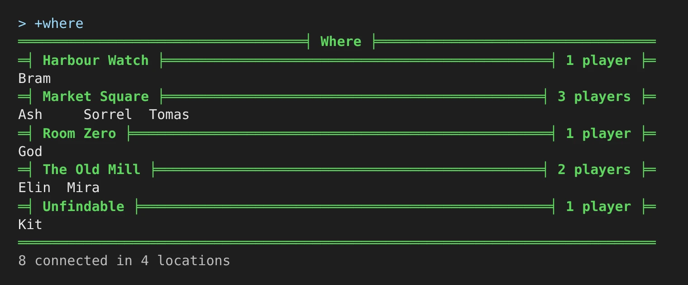
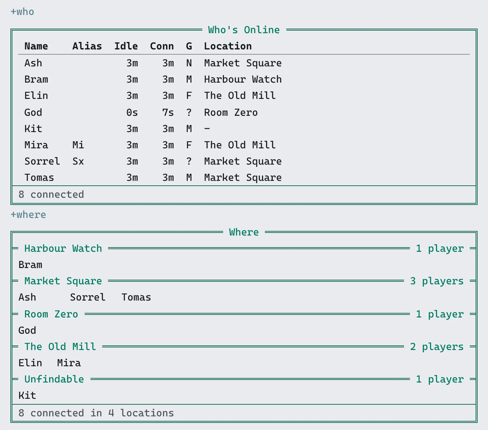
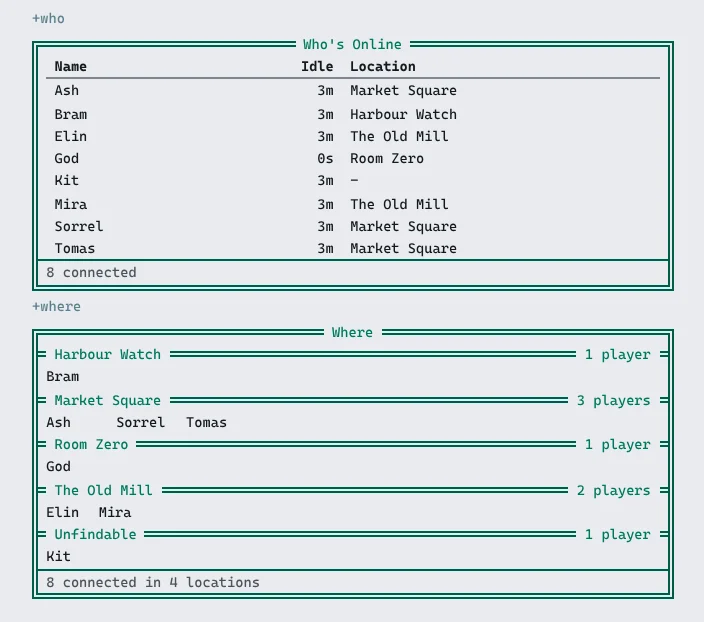

The **who-where** package gives a game two commands:

- `+who` lists everyone connected: their alias, how long they have been idle and connected, their
  gender and where they are.
- `+where` shows where everyone connected is standing.

In the game, `+help who` and `+help where` have the same commands in short form. The examples
below are what God saw with seven players connected.

## +who

`+who` lists everyone by name. The columns are the ones most who lists on other games share:
name, alias, idle time, time connected, the first letter of the player's `@sex` (`?` when it is
not set), and location.

```
> +who
+==============================< Who's Online >==============================+
| Name    Alias  Idle  Conn  G  Location                                     |
| -------------------------------------------------------------------------- |
| Ash              4m    4m  N  Market Square                                |
| Bram             4m    4m  M  Harbour Watch                                |
| Elin             4m    4m  F  The Old Mill                                 |
| God              0s    5s  ?  Room Zero                                    |
| Kit              4m    4m  M  -                                            |
| Mira    Mi       4m    4m  F  The Old Mill                                 |
| Sorrel  Sx       4m    4m  ?  Market Square                                |
| Tomas            4m    4m  M  Market Square                                |
+============================================================================+
| 8 connected                                                                |
+============================================================================+
```

A player who has been idle for an hour or more has their name drawn muted, so the people who are
around stand out.

`+who/idle` lists the same players with the least idle first.

`+who` followed by a name lists only the players whose name or alias starts with it. The footer
says how many of everyone connected it shows:

```
> +who mi
+==============================< Who's Online >==============================+
| Name  Alias  Idle  Conn  G  Location                                       |
| -------------------------------------------------------------------------- |
| Mira  Mi       4m    4m  F  The Old Mill                                   |
+============================================================================+
| 1 of 8 connected                                                           |
+============================================================================+

> +who zz
[WHO] Warning: Nobody connected has a name starting with zz.
```

A Status column appears when another package gives some player a status, such as `+status lfrp` from
[Status](/guides/status). How a package adds one, for example to mark staff, is in
`+help who filters`.

## +where

`+where` has three views.

### Under each location

`+where` on its own gives each location a line with its name and how many players are there, and
lists those players under it, as many to a line as fit. Locations are sorted by name, and so are
the players in each.

```
> +where
===================================< Where >==================================
=< Harbour Watch >===============================================< 1 player >=
Bram
=< Market Square >==============================================< 3 players >=
Ash     Sorrel  Tomas
=< Room Zero >===================================================< 1 player >=
God
=< The Old Mill >===============================================< 2 players >=
Elin  Mira
=< Unfindable >==================================================< 1 player >=
Kit
==============================================================================
8 connected in 4 locations
```

In a terminal that shows UTF-8 the lines are drawn with box characters:



Two rooms with the same name get a line each.

`+where` sends the locations in up to 20 parts, then the count, so it keeps working with thousands
of players connected, each in a room of their own.

### One player per line

`+where/room` lists one player per line, sorted by location and then by name:

```
> +where/room
+============================< Where by location >===========================+
| Name    Location                                                      Idle |
| -------------------------------------------------------------------------- |
| Bram    Harbour Watch                                                   4m |
| Ash     Market Square                                                   4m |
| Sorrel  Market Square                                                   4m |
| Tomas   Market Square                                                   4m |
| God     Room Zero                                                       0s |
| Elin    The Old Mill                                                    4m |
| Mira    The Old Mill                                                    4m |
| Kit     -                                                               4m |
+============================================================================+
| 8 connected                                                                |
+============================================================================+
```

`+where/name` lists the same, sorted by name:

```
> +where/name
+==============================< Where by name >=============================+
| Name    Location                                                      Idle |
| -------------------------------------------------------------------------- |
| Ash     Market Square                                                   5m |
| Bram    Harbour Watch                                                   5m |
| Elin    The Old Mill                                                    5m |
| God     Room Zero                                                       0s |
| Kit     -                                                               5m |
| Mira    The Old Mill                                                    5m |
| Sorrel  Market Square                                                   5m |
| Tomas   Market Square                                                   5m |
+============================================================================+
| 8 connected                                                                |
+============================================================================+
```

Any other switch is refused:

```
> +where/bogus
[WHERE] Warning: +where has no /bogus switch. +where/room lists by location, +where/name by name.
```

### Unfindable players

A player who is unfindable, or who stands in an unfindable room, is listed under **Unfindable**
in `+where`, and at `-` in `+who` and the one-per-line views. In the examples, Kit is in
Smugglers' Cove, which is set `UNFINDABLE`. This holds for staff too: who-where looks players up
as its own object, not as the reader.

## In the portal and on a phone

Every view fills the reader's screen. In the portal it is drawn as a card:



On a narrow screen the less important columns go first: gender, then alias, then time connected.
Name, idle time and location stay. The location lines in `+where` keep their counts, and the
names under them take fewer to a line:



## Installing

who-where ships with the server but is not installed on a new game. An administrator installs
it from the portal: open **Packages** in the admin area, choose **Browse**, and install
`who-where`. It needs `plus-help`, which a new game already has.

See [Softcode Packages](/guides/packages) for how installing, upgrading and rolling back work.
