A fact is a property of a wiki page and its value: a spell's level, its traditions, the class that
casts it. Facts are held by the page beside its categories, not written in its text, so changing
them adds no revision and a translation has the same facts as its page.

| You want to | Read |
|---|---|
| see a page's facts | [Reading facts](#reading-facts) |
| define the properties facts may state | [Properties](#properties) |
| set facts in the portal | [In the portal](#in-the-portal) |
| set facts in the game | [In the game](#in-the-game) |
| use facts in softcode | [From softcode](#from-softcode) |
| find the pages that state a value | [Finding pages by their facts](#finding-pages-by-their-facts) |

The examples use a **Wizard** page and the spells in a **Spells** category, such as **Fireball** and **Shield**.

## Reading facts

A page with facts lists them under its text, above its categories, each under its property's label.
A value that names a page links to that page. Any other value links to the other pages that state
it.

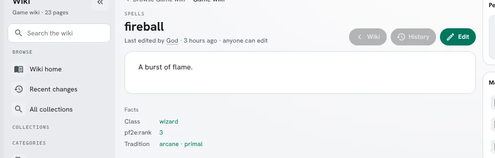

Under **Named by**, a page lists the pages whose facts name it, by property. A page shows up to 20
for each property; when more name it, **all** lists every one.

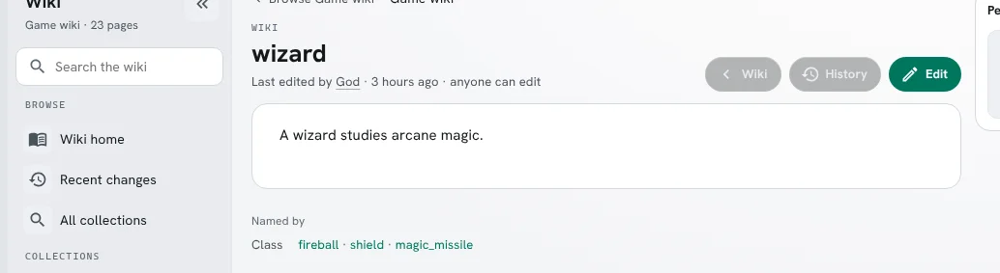

Following a value that does not name a page opens **Pages by fact**, which lists the pages that
state it. Its box holds the query, so you can change it and press **Find** again.

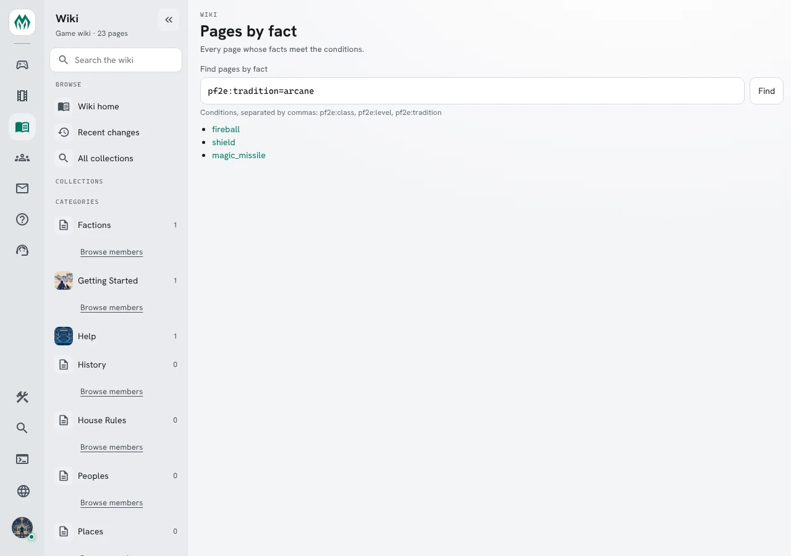

A property with no label is shown by its key, as `pf2e:rank` is above. A fact that names a page you
may not read is left out, and so is a page you may not read that names this one.

## Properties

A page states only properties the game defines. Each property has a name in two parts,
`<group>:<name>`, such as `pf2e:level`, and a type: `number`, `keyword`, `page` or `boolean`. A
property takes one value per page unless it allows several. A keyword property can list the
keywords it allows; with none listed, it allows any. A label and a description tell readers what
it records. Changing properties needs the wiki.admin permission.

Changing or removing a property leaves the facts pages already state. A page keeps a value its
property no longer takes until someone changes that property on it, and a property defined again
finds the pages that state it.

### Properties in the portal

**Wiki pages** under **Build & manage** has a **Fact properties** card listing every property.
**+** defines a new one; the pencil changes one and the bin removes it.

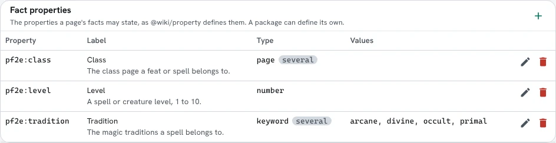

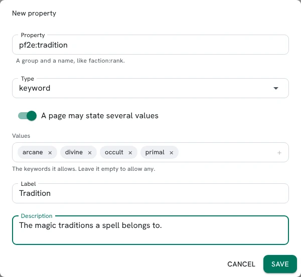

A definition the wiki refuses, such as a name without a group, is not saved, and the reason is shown.

### Properties in the game

`@wiki/property` lists the properties and `@wiki/property <property>` shows one.
`@wiki/property <property>=<type>` defines a property or changes its type, and
`@wiki/property <property>=` removes it. `@wiki/property <property>/<field>=<value>` sets one of
`label`, `description`, `values` (keywords separated by `|`) or `multiple` (`yes` or `no`).

```text
> @wiki/property
+-----------------------------< Wiki properties >----------------------------+
| Property        Type     Values   Label                                    |
| --------------------------------------------                               |
| pf2e:class      page     several  Class                                    |
| pf2e:level      number   one      Level                                    |
| pf2e:tradition  keyword  several  Tradition                                |
+----------------------------------------------------------------------------+
> @wiki/property pf2e:tradition
+------------------------< Property: pf2e:tradition >------------------------+
| Type:        keyword                                                       |
| Values:      several                                                       |
| Allowed:     arcane | divine | occult | primal                             |
| Label:       Tradition                                                     |
| Description: The magic traditions a spell belongs to.                      |
+----------------------------------------------------------------------------+
> @wiki/property faction:rank=keyword
WIKI: Defined faction:rank: keyword.
> @wiki/property faction:rank/values=captain|sergeant
WIKI: Changed faction:rank. Pages that state it keep their facts.
> @wiki/property faction:rank=
WIKI: Removed faction:rank. Pages that state it keep their facts.
```

### Properties in a package

A package defines the properties its pages state under `wiki_properties:` in its `package.yaml`,
which needs `format: "1.17"` or later; an older format ignores the block with a warning. Installing
the package defines the properties, and removing it removes them. A property the game defined first
stays the game's. The install is refused unless that property has the same type, takes one value or
several as the package does, and allows every keyword the package lists: a `pf2e:tradition` that
takes one value refuses the package below, which states several.

```yaml
format: "1.17"
wiki_properties:
  pf2e:tradition:
    type: keyword
    multiple: true
    values: [arcane, divine, occult, primal]
    label: Tradition
```

## In the portal

Editing a page shows its facts below its categories. Each fact is a box with its property and its
value; × removes it. **Add a fact** offers the properties the page can still take: a property that
takes one value is not offered again once the page has it.

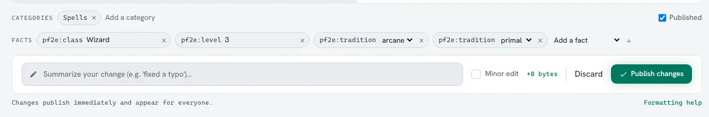

The value control follows the property's type:

| Type | Control | Example |
|---|---|---|
| Whole number | number box | `3` |
| Keyword | list of the property's keywords | `arcane` |
| True or false | true/false list | `true` |
| Page | text box, the page's title | `Wizard`, `Help:Fireball` |

**Publish changes** saves the facts with the rest of the edit. When a value is refused, the facts
are not changed, the editor stays open, and the reason is shown under it:

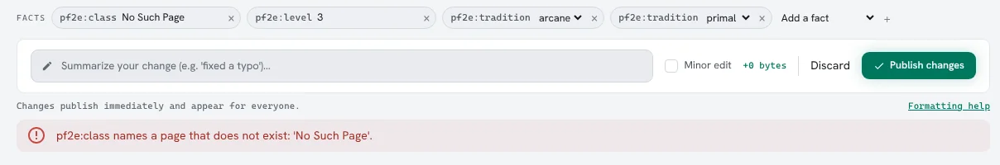

A translation shows its page's facts but cannot change them.

## In the game

`@wiki <page>` shows a page's facts under its text, then the pages that name it. In a client that
can click, a page runs `@wiki` for that page, and any other value runs `@wiki/query` for the pages
that state it.

```text
> @wiki wizard
──────────────────────────────────────────────────────────────────────────────
Wiki: wizard [main]
Categories: -   Rev 1 — 2026-10-23 15:21
──────────────────────────────────────────────────────────────────────────────
A wizard studies arcane magic.
─────────────────────────────────┤ Named by ├─────────────────────────────────
Class: fireball · shield · magic_missile
──────────────────────────────────────────────────────────────────────────────
```

`@wiki/fact <page>` shows a page's facts alone. `@wiki/fact <page>/<property>=<values>` replaces one
property's values; separate several with `|`, and leave nothing after `=` to clear them.

```text
> @wiki/fact fireball
+-----------------------------< Facts: Fireball >----------------------------+
| pf2e:class:     Wizard                                                     |
| pf2e:level:     3                                                          |
| pf2e:tradition: arcane | primal                                            |
+----------------------------------------------------------------------------+
> @wiki/fact fireball/pf2e:tradition=arcane|divine
WIKI: 'Fireball' pf2e:tradition: arcane | divine.
> @wiki/fact fireball/pf2e:level=two
WIKI: pf2e:level is a whole number, not 'two'.
```

Setting a fact is an edit, so the page's edit requirements apply.

## From softcode

`wikifact(<page>)` lists the properties a page has facts for. `wikifact(<page>, <property>)`
returns that property's values, separated by spaces or by a delimiter you give. A value that names
a page comes back as that page's reference.

```text
> think wikifact(fireball)
pf2e:class pf2e:level pf2e:tradition
> think wikifact(fireball, pf2e:class)
main:wizard
> think wikifact(fireball, pf2e:tradition, %b-%b)
arcane - primal
```

## Finding pages by their facts

A query lists the pages whose facts meet every condition. It takes up to four conditions:

| Condition | A page meets it when it |
|---|---|
| `pf2e:tradition=arcane` | states that value; a page is named by its title |
| `pf2e:tradition=arcane\|divine` | states either value |
| `pf2e:tradition!=arcane` | does not state it |
| `pf2e:class=*` | states any value |
| `pf2e:class!=*` | states none |
| `pf2e:level>3`, `<3`, `>=3`, `<=3` | states a whole number above, below, at least or at most 3 |
| `pf2e:level=1..3` | states a whole number from 1 to 3; leave an end off for no limit, as in `..2` |

A query needs one condition a page meets by stating a value, or a sort: `!=` alone finds no pages.
These settings go with the conditions:

| Setting | What it does |
|---|---|
| `category=<name>`, `namespace=<name>` | limit where the pages come from |
| `sort=<property>` | orders the pages by a number or keyword; a page that states none is left out |
| `order=desc` | puts the highest first; `order=asc`, the default, the lowest |
| `show=<property>\|<property>` | lists up to four properties' values beside each page |

Following a fact's value opens **Pages by fact**, a box that searches the whole wiki: type the
conditions, separated by commas, and press **Find**. When there are more pages than one answer
holds, **More** reads the rest. With `show=`, the pages come as a table, a column for each property:


A condition the wiki cannot answer is refused with the reason:

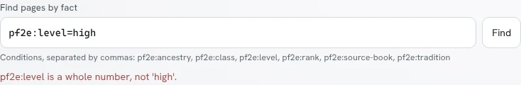

In the game, `@wiki/query` lists the pages, and `wikiquery()` returns their references:

```text
> @wiki/query pf2e:tradition=arcane, pf2e:level=1..3
+---------< 5 page(s) where pf2e:tradition=arcane, pf2e:level=1..3 >---------+
| Page                 Title           Rev  Edited                           |
| ----------------------------------------------------                       |
| main:fireball        Fireball          2  2026-10-22                       |
| main:shield          Shield            1  2026-10-23                       |
| main:magic_missile   Magic Missile     1  2026-10-23                       |
| main:lightning_bolt  Lightning Bolt    1  2026-10-23                       |
| main:haste           Haste             1  2026-10-23                       |
+----------------------------------------------------------------------------+
> think wikiquery(category=Spells, pf2e:class=Wizard)
main:fireball main:shield main:magic_missile
> think wikiquery(pf2e:level=..1, pf2e:tradition=divine)
main:shield main:heal
> @wiki/query pf2e:level=high
WIKI: pf2e:level is a whole number, not 'high'.
> think wikiquery(pf2e:level=1..x)
#-1 INVALID WIKI QUERY
```

With `show=`, `@wiki/query` lists the values in place of the revision and date. `wikiquery()` returns
pages only, so it refuses `show=`; read a page's values with `wikifact()`.

```text
> @wiki/query pf2e:tradition=arcane, pf2e:level>1, sort=pf2e:level, show=pf2e:level
+< 1 page(s) where pf2e:tradition=arcane, pf2e:level>1, sort=pf2e:level, show+
| Page           Title       Level                                           |
| --------------------------------                                           |
| main:fireball  fireball    3                                               |
+----------------------------------------------------------------------------+
> think wikiquery(pf2e:tradition=arcane, sort=pf2e:level, order=desc)
main:fireball main:magic_missile main:shield
> @wiki/query pf2e:level!=1
WIKI: A query needs a condition a page meets by stating a value; != alone finds no pages.
```

A query leaves out every page you may not read.

### A query in a page's text

A `::: facts` block in a page's text lists the pages its query finds, each time the page is read, so
the list keeps up with the wiki. The conditions and settings follow `facts` on the opening line, as
`@wiki/query` takes them, and a bare `:::` closes the block. It is a query, not softcode, so it runs
nothing.

```markdown
Every arcane spell, highest level first:

::: facts pf2e:tradition=arcane, sort=pf2e:level, order=desc, show=pf2e:level|pf2e:class
:::
```

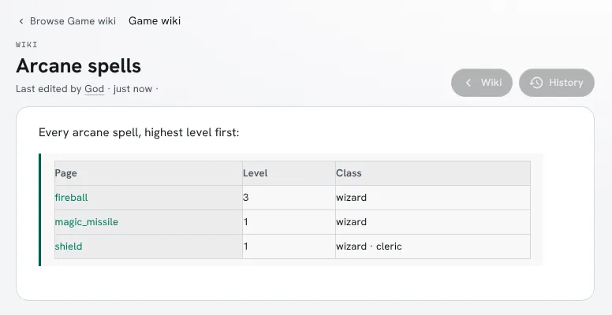

`@wiki` shows the same table, up to 20 pages, with a link to the rest. A query the wiki cannot answer
shows the reason where the block is. Elsewhere, such as `rendermarkdown()`, the block is a note that
the list is on the web portal.

```text
> @wiki arcane_spells
------------------------------------------------------------------------------
Wiki: Arcane spells [main]
Categories: -   Rev 1 - 2026-10-23 20:06
------------------------------------------------------------------------------
Every arcane spell, highest level first:

Page           Level  Class
-------------------------------------
fireball       3      wizard
magic_missile  1      wizard
shield         1      wizard * cleric
------------------------------------------------------------------------------
```

### Filtering a category

A category page lists, above its pages, each property its pages state, with the values they state
and how many pages state each. A property shows its twelve most stated values. When a whole-number
property has more than six values, they are counted in up to six ranges instead.

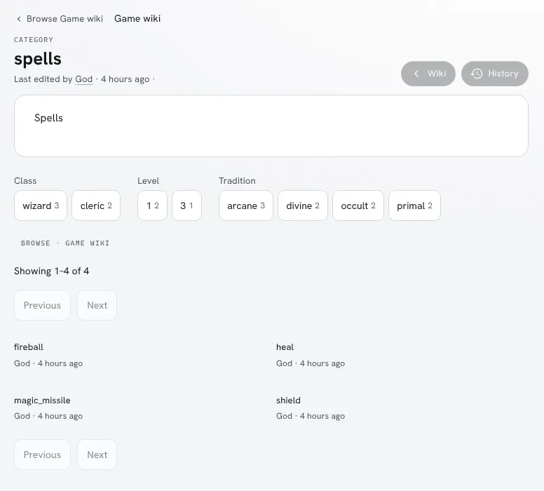

Choosing a value replaces the category's pages with the pages that state it, as a table with a
column for each property you chose from. Choosing a second value of the same property finds pages
that state either; a whole number takes one value or range at a time. Each property counts the pages
that meet your other choices, so its other values stay listed. **Clear filters** shows the
category's pages again.

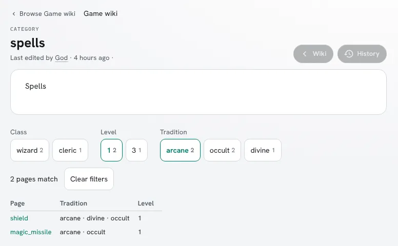

In the game, `@wiki/facets <category>` lists the same counts, and conditions after `=` narrow them.
In a client that can click, a value narrows the list, and **List them** runs `@wiki/query` for the
pages counted.

```text
> @wiki/facets spells
+-----------------------------< Facets: spells >-----------------------------+
| 4 page(s).                                                                 |
| Class:     wizard (3) * cleric (2)                                         |
| Level:     1 (2) * 3 (1)                                                   |
| Tradition: arcane (3) * divine (2) * occult (2) * primal (2)               |
+----------------------------------------------------------------------------+
> @wiki/facets spells=pf2e:tradition=arcane
+-----------------------------< Facets: spells >-----------------------------+
| 3 page(s) where pf2e:tradition=arcane. List them                           |
| Class:     wizard (3) * cleric (1)                                         |
| Level:     1 (2) * 3 (1)                                                   |
| Tradition: arcane (3) * divine (2) * occult (2) * primal (2)               |
+----------------------------------------------------------------------------+
```

### The fact index

Queries read an index of every page's facts. The server builds it in the background when it starts,
and every edit keeps it up to date from then on. Until it is built, a query answers that the index is
still building: `#-1 WIKI INDEX BUILDING` in softcode.

`@wiki/fact/index` shows how far the index has come. `@wiki/fact/index rebuild` empties it and
builds it again, and needs the wiki.admin permission.

```text
> @wiki/fact/index
WIKI: The fact index is ready: 10 pages.
```

The in-game help has the same in short form: `help wiki facts`, `help wikifact()` and
`help wikiquery()`.
