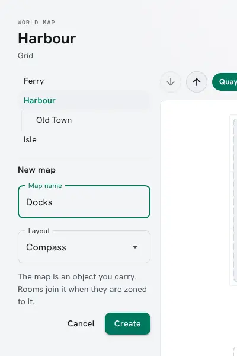
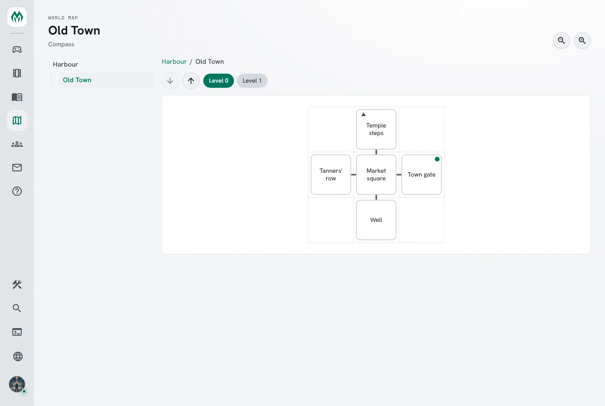
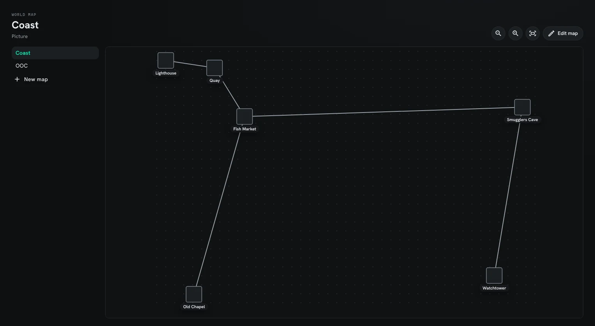
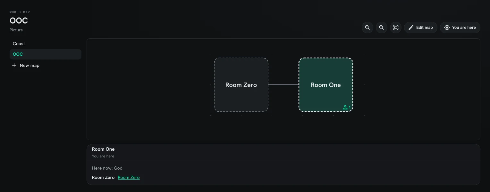
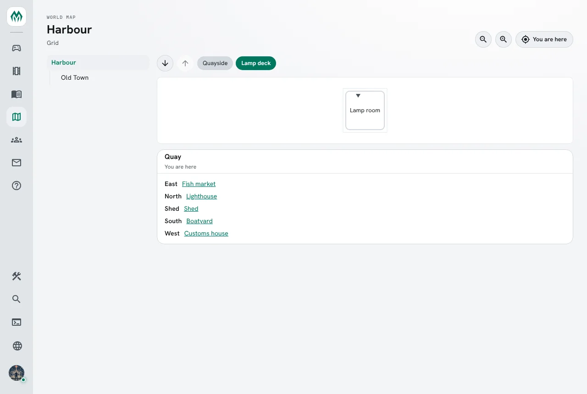
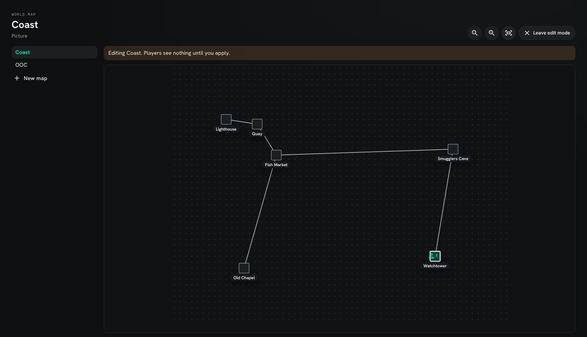
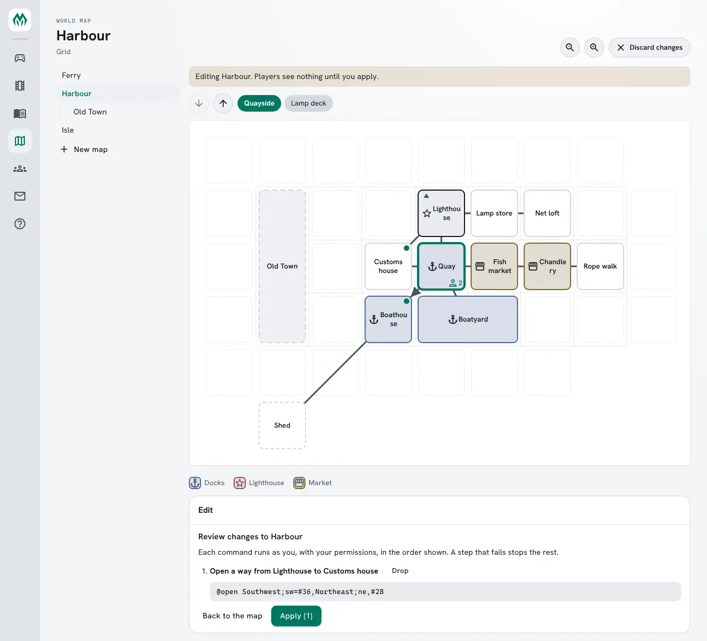
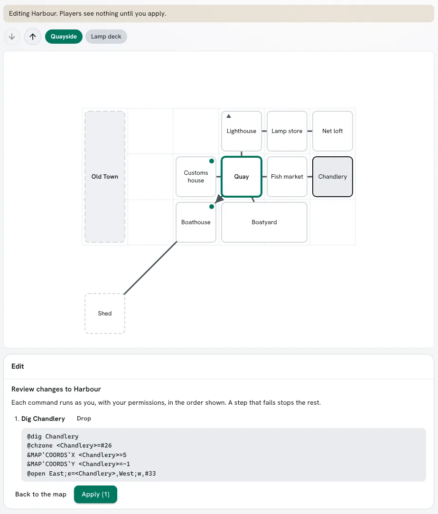
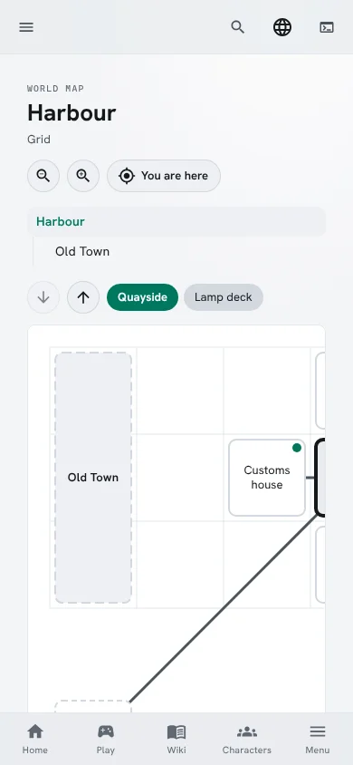

The **World map** is a portal page that draws the game's maps. Each map is drawn from its rooms and
the exits between them, one level at a time, and the room you are in is marked. Choosing a room
lists its exits; choosing an exit's room moves to it, and an exit that leads to another map opens
that map.


This page covers:

- [Setting it up](#setting-it-up)
- [Making a map](#making-a-map)
- [How a map is drawn](#how-a-map-is-drawn)
- [Moving around a map](#moving-around-a-map)
- [Levels](#levels)
- [Kinds of place](#kinds-of-place)
- [Several maps](#several-maps)
- [Regions](#regions)
- [Picture maps](#picture-maps)
- [Getting there](#getting-there)
- [Changing a map in the portal](#changing-a-map-in-the-portal)
- [Who sees what](#who-sees-what)

## Setting it up

The World map is the **World map** package. First-run setup offers it ticked under Building in its last step;
a game that is already running installs it from the portal's Packages page. Once it is installed, **World map** appears in
the portal's menu. On a game with +help, ticking it in setup also brings **World map: +help
topics**, which adds `+help map`.

## Making a map

A map is a thing whose `` MAP`KIND `` attribute says how it is drawn. A room is on the map that is
its zone, so `@chzone` puts a room on a map.

A builder, standing in a room called Boathouse:

```
> @create Harbour
Created: Object #32.
> &MAP`KIND Harbour=coordinates
Harbour/MAP`KIND - Set.
> @chzone here=Harbour
Unlocked zone Harbour(#32Tn) - automatically zone-locking to itself
Zone changed.
> &MAP`COORDS`X here=3
Boathouse/MAP`COORDS`X - Set.
> &MAP`COORDS`Y here=-1
Boathouse/MAP`COORDS`Y - Set.
```

Do the same in each room of the harbour. Harbour now shows in the World map's list.

**New map**, under the map list in the portal, runs the first two commands for you and opens the
new map. It shows to a character who may `@create`. The map object stays in your inventory.
Destroying it takes the map away.



## How a map is drawn

`` MAP`KIND `` is one of three:

| Kind | Shown as | A room's place |
|---|---|---|
| `coordinates` | Grid | the cell its `` MAP`COORDS`X ``, `` MAP`COORDS`Y `` and `` MAP`COORDS`Z `` name |
| `compass` | Compass | worked out from its exits: a room north of another is drawn above it |
| `graph` | Picture | the point its `` MAP`POS`X `` and `` MAP`POS`Y `` name, with no grid |

North is up. On a compass map, `up` and `down` exits change the level (see [Levels](#levels)).

A room covers one cell unless its `` MAP`SIZE`W `` and `` MAP`SIZE`H `` say more. The cell its
coordinates name is its south-west corner, so `&MAP`SIZE`W Boatyard=2` makes the Boatyard two cells
wide, reaching east.

A compass map keeps any coordinates a room does have and places the rest by their exits, so a few
coordinates can pin down where a large area sits. Exits named or aliased `n`, `north`, `ne`,
`northeast` and so on, `u`, `up`, `d` and `down` count; other exits are drawn as lines between
rooms but do not place them.



A room the map cannot place, such as a room on a grid map with no coordinates, is drawn with a
dashed edge in a row below the others, on the level of a room its exits join it to.

## Moving around a map

A map opens at the size that fits its frame, with the room you are in in the middle. The zoom
buttons above the map make it larger or smaller around the middle of the view, and **Fit the map**
fits it again. Drag with the mouse, scroll, or swipe with one finger to move across a map larger
than its frame. To zoom about a spot, pinch on a touch screen or trackpad, or hold Ctrl and use the
mouse wheel.

Lines stay the same width at any size, and room names grow and shrink with the map. A room too
small to hold its name has the name on a label under it; smaller still, the name shows only when
you point at the room, and a screen reader still reads it.



**You are here** brings your room to the middle of the view. While you are looking at the World
map, not editing it, it follows you: when you walk to another room, that room is marked and brought to the middle, and when
you walk onto another map, that map opens.



## Levels

Z is the level. A `coordinates` or `compass` map shows one level at a time, with a button for each
level and arrows that step up and down. A room with an exit up or down is marked with a small
arrow, and choosing that exit's room in the room's exits goes to its level.

`` MAP`LEVEL`<level> `` names a level; a level without a name is shown as its number.
`` MAP`LEVEL `` is the level a visitor sees first. Someone standing on the map starts on their own
level.

```
> &MAP`LEVEL`-1 Harbour=Sewers
Harbour/MAP`LEVEL`-1 - Set.
> &MAP`LEVEL Harbour=-1
Harbour/MAP`LEVEL - Set.
```



## Kinds of place

A room's `ENVIRONMENT` attribute says what kind of place it is, such as `dock` or `market`. The
gmcp-room package sends the same attribute to a MUD client's mapper. The map's legend says how each
kind is drawn. Each part is an attribute of its own on the map object:
`` MAP`LEGEND`<kind>`LABEL ``, `` `TONE `` (a `tone()` colour name) and `` `ICON ``. A map inside
another map uses the outer map's legend, unless it names that kind itself.

```
> &ENVIRONMENT Quay=dock
Quay/ENVIRONMENT - Set.
> &MAP`LEGEND`DOCK`LABEL Harbour=Docks
Harbour/MAP`LEGEND`DOCK`LABEL - Set.
> &MAP`LEGEND`DOCK`TONE Harbour=blue
Harbour/MAP`LEGEND`DOCK`TONE - Set.
> &MAP`LEGEND`DOCK`ICON Harbour=anchor
Harbour/MAP`LEGEND`DOCK`ICON - Set.
```

An icon is one of `water`, `forest`, `park`, `mountain`, `road`, `home`, `shop`, `food`, `drink`,
`bed`, `temple`, `castle`, `shield`, `anchor`, `star`, `chat`, `book`, `mask`, `lock` and `flag`, or
one or two characters drawn as text. The legend under the map lists only the kinds its rooms
use.

Choosing a room also shows its description, and the players there whom you could find with
`loc()`. A room with players in it shows how many.


A new game's starter world has two zones drawn this way, OOC and IC. The arrival room, Room Zero,
is on the OOC zone, and its **In Character** exit leads to the Commons, the first room in character. That exit lets
through only approved characters and staff.

## Several maps

A game may have as many maps as it likes, each of its own kind. An exit from a room on one map to
a room on another is drawn as a dot on the room it leaves; in the room's exits it reads
**To the map** and the map's name, and choosing it opens that map.

## Regions

A map zoned to another map is a region inside it, as a room zoned to a map is on it. Regions nest
as deep as you like: Sol System, Earth, United States, New York, Brooklyn.

A region is listed under its map, and the maps it is inside are named above it, each a link. On
its map, a region is a grey box that opens it. The box goes where the region's own
`` MAP`COORDS `` (`` MAP`POS `` on a graph map) and `` MAP`SIZE `` say, as a room's would; without
them it is drawn in the row below. While you stand anywhere inside a region, its box is marked.

Holding the Old Town map, with the Harbour beside it:

```
> @chzone Old Town=Harbour
Zone changed.
> &MAP`COORDS`X Old Town=0
Old Town/MAP`COORDS`X - Set.
> &MAP`COORDS`Y Old Town=-2
Old Town/MAP`COORDS`Y - Set.
> &MAP`SIZE`H Old Town=3
Old Town/MAP`SIZE`H - Set.
```

Old Town is now listed under Harbour, and drawn on the Harbour's left, three cells tall.

## Picture maps

A `graph` map can be drawn on a picture. `` MAP`BACKDROP `` holds the picture's address: a path
on the game's own site, such as the link of an image in the wiki's image library, or an `https`
address. Any other address is not shown. `` MAP`SIZE`W `` and `` MAP`SIZE`H `` are the picture's
size in pixels.

Each room's `` MAP`POS`X `` and `` MAP`POS`Y `` are then a point on the picture, in pixels from its
top left corner. A room is drawn as a pin with its name under it, unless it has a `` MAP`SIZE `` of
its own: then it is an area of that many pixels around its point.

A `graph` map with no picture draws each room without a `` MAP`SIZE `` as a box, as large as a grid
cell, on a ground of faint dots; a room with a `` MAP`SIZE `` keeps that size. `` MAP`POS`X `` and `` MAP`POS`Y `` are then the box's centre, in the same units, so rooms 96
apart sit side by side.

Holding the Isle map:

```
> &MAP`BACKDROP Isle=/api/wiki-assets/fd8b00b0889f4bee97f0eb7f7a8849f7/isle.png
Isle/MAP`BACKDROP - Set.
> &MAP`SIZE`W Isle=900
Isle/MAP`SIZE`W - Set.
> &MAP`SIZE`H Isle=640
Isle/MAP`SIZE`H - Set.
```

## Getting there

Choosing a room shows the way there from where you stand: the exits to take in turn, over the
exits you can see, on this map or across others. The way is drawn on the map, and under the room's
exits is one line you can paste into any client. **Walk there** runs it as your character.


`walk` takes exits separated by spaces and stops at the first exit that refuses you, such as a
locked door. An exit whose name has a space is written by its first alias without one, or else in
double quotes: `walk "Old gate" north`.

## Changing a map in the portal

If you control a map, the World map shows **Edit map**. While you edit, nothing reaches the game,
and the map shows what it will look like once your changes run.

- Choose a room you control to rename or describe it, set its place or size, dig a room above or
  below it, or take it off the map. A room you do not control is drawn faded and cannot be changed.
- A chosen room lists its exits. Rename or destroy one you control, or open a way to another room
  on the map, or to any room by its dbref, which links one map to another. A way to a room off
  the map shows that room's name. An exit name the room already uses is refused.
- On a map with no rooms, choose any cell to dig the first one. It has no exit yet.
- Choose an empty cell next to a room, or a spot on a picture map, to dig a room there, with a
  description if you like. A picture map with no picture leaves room around its rooms to choose a
  spot in, so a room can be placed or moved well away from the others. It is joined to the room straight beside it by an exit and, if you like,
  an exit back; on a grid the names follow the direction, such as `East;e` there and `West;w` back.
  `in` and `i` are refused as exit names, as `i` is the inventory.
- Add a room you control that this map's exits lead to and that is on no map, or a room by its
  dbref.
- On a grid, name the level on show.
- **Map settings** changes the map itself: its name, the map it sits inside, the level it opens
  on, its legend's types with a colour and an icon each, and on a picture map the picture and its
  size. Pick the picture from the media library or upload one; its size is read from the picture.
- **Go there** on a room or a place takes you there, so you can look at what you built.
- On a world map, the World map section paints its places and sets their sides, names and rooms.
  See [Large Maps](/guides/large-maps/#changing-a-world-map-in-the-portal).




**Review and apply** lists each change as the commands it runs. When your quota limits what you
build, the review counts the rooms and exits the changes make, and a plan that needs more than you
have left cannot be applied. **Apply** runs the commands as you, with your permissions, one after
another, and checks each one. The first that fails stops the rest, and the list that follows says
which changes ran.





On the Isle, digging a Tar shed at a spot joined to the Ford runs:

```
> @dig Tar shed
Tar shed created with room number 115.
> @chzone #115=Isle
Zone changed.
> &MAP`POS`X #115=380
Tar shed/MAP`POS`X - Set.
> &MAP`POS`Y #115=520
Tar shed/MAP`POS`Y - Set.
> @open Tar lane;tar=#115,Ford path;fp,#73
Opened exit #116
Trying to link...
Linked exit #116 to #115
Opened exit #117
Trying to link...
Linked exit #117 to #73
```

## Who sees what

A map is listed to everyone once its `` MAP`KIND `` is set and it holds something they may see. A
map with nothing they may see is listed only to whoever controls it. Each player sees only the
rooms they could see in the game: a `DARK` room is left out unless they can examine it, and so are
its exits.
The page shows the map as the character you are playing, and changes when you switch characters.

Apps you allow to **Run commands** can read the same maps. See
[Apps That Act for You](/guides/connected-apps/).

On a phone the list of maps sits above the map, and the map scrolls inside its frame.


