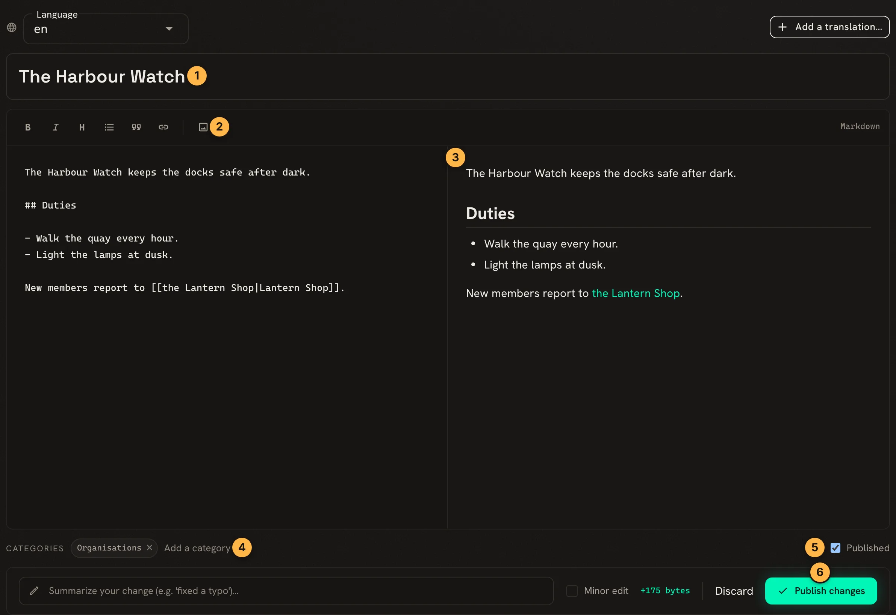
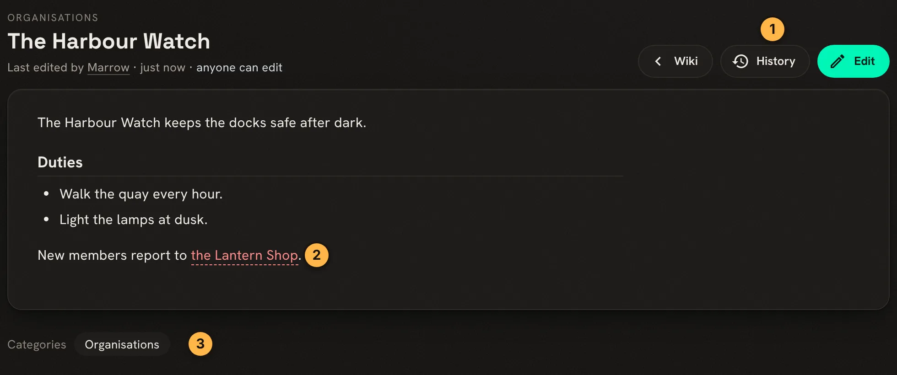

Every SharpMUSH game has a wiki for its longer writing: the setting, its people and places, the
house rules. Pages are written in Markdown, in the portal's editor or with `@wiki` in the game.
Both work on the same pages, so a page started in one can be finished in the other.

The examples follow Marrow, an approved character, writing a page about the Harbour Watch.

## Who can write

A new game lets `approved` characters create and edit pages, and staff through `wiki.admin`. A
character without them can read but not write:

```
> @wiki/append the_harbour_watch=More.
WIKI: You can't edit 'The Harbour Watch': needs wiki.edit.
```

[Approving a character](/guides/roles/#approving-a-character) gives them both.

## Writing a page in the portal

Open **Wiki** and choose **New page**. The editor shows the Markdown on the left and the page as
it will look on the right:



1. The page's title.
2. The toolbar adds bold, italics, headings, lists, quotes, links and pictures.
3. The preview updates as you type.
4. Type a category and press Enter to file the page in it.
5. **Published** is ticked for a page everyone can read. Untick it to keep the page a draft.
6. **Publish changes** saves the page.

The saved page:



1. **History** lists every revision. **Edit** opens the editor again.
2. A link to a page that does not exist yet shows in red.
3. The page's categories. Each one is a page listing its members.

## Linking pages

`[[Page Name]]` links to another page, showing its title. To show different words, put them first:

```
New members report to [[the Lantern Shop|Lantern Shop]].
```

shows "the Lantern Shop" and links to the page Lantern Shop. A link can point into another
namespace, such as `[[Help:Markdown Guide]]`.

## Writing in the game

`@wiki/create` starts a page and `@wiki/append` adds a paragraph to the end of one:

```
> @wiki/append/noeval the_harbour_watch=Ask [[Marrow]] for the night rota.
WIKI: Appended to 'The Harbour Watch' (now rev 2).
```

`@wiki` evaluates what you type as softcode, so `[[Marrow]]` would lose its brackets. `/noeval`
keeps the text as typed. `%r` puts in a line break when you do want evaluation:
`@wiki/create Docks=The docks.%r%r## Berths`.

`@wiki/edit` replaces the whole text of a page, and `@wiki/md` shows a page's Markdown so you can
copy it first. `@wiki <page>` reads it.

## Undoing an edit

Every save is a revision. `@wiki/history` lists them:

```
> @wiki/history the_harbour_watch
+==============< Revision history for The Harbour Watch [main] >=============+
| Rev  Edited            By      Summary                                     |
| -------------------------------------------------------------------------- |
|  r2  2026-11-13 09:53  Marrow  appended in-game via @wiki/append           |
|  r1  2026-11-13 09:52  Marrow                                              |
+============================================================================+
```

`@wiki/rollback` puts an earlier revision back as a new one, so the rollback can be undone too:

```
> @wiki/rollback the_harbour_watch=1
WIKI: Restored 'The Harbour Watch' to r1 (now rev 3).
```

In the portal, **History** does the same: pick two revisions and **Compare selected** shows what
changed, and the restore button beside a revision puts it back.

## Protecting a page

Staff with `wiki.admin` can stop a page being changed by anyone without it:

```
> @wiki/protect the_harbour_watch
WIKI: 'The Harbour Watch' is now protected (editing and deleting need wiki.admin).
```

Marrow, trying to add to it, gets
`WIKI: You can't edit 'The Harbour Watch': the page requires wiki.admin.`
`@wiki/unprotect` lifts it. A whole namespace or category can require a permission in the same way:
see `help wiki requirements`.

## Next steps

- [Reading the Wiki In-Game](/guides/wiki-reader) for `+wiki`, which reads pages laid out for a
  MU\* client.
- [Wiki Facts](/guides/wiki-facts) to give pages facts, such as a spell's level.
- `help wiki`, `help wiki editing` and `help wiki categories` in the game.
