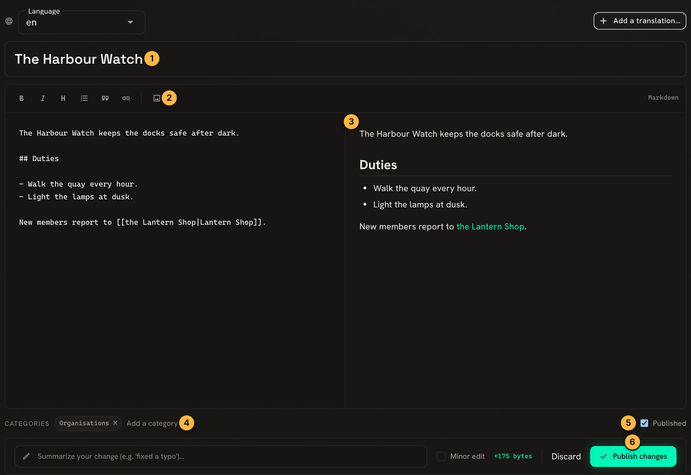
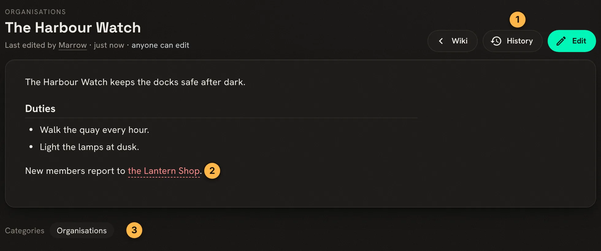
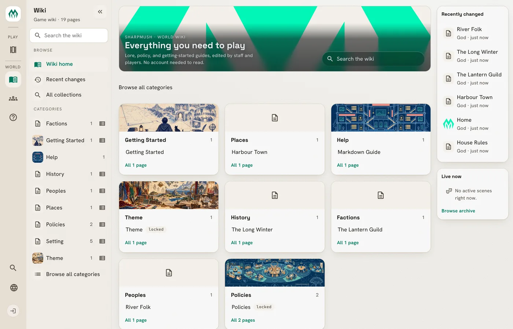

Every SharpMUSH game has a wiki for its longer writing: the setting, its people and places, the
house rules. Pages are written in Markdown, in the portal's editor or with `@wiki` in the game.
Both work on the same pages, so a page started in one can be finished in the other.

The examples follow Marrow, an approved character, writing a page about the Harbour Watch.

## Who can write

A new game lets `approved` characters create and edit pages, and staff through `wiki.admin`. A
character without them can read but not write:

```
> @wiki/append the_harbour_watch=More.
WIKI: You can't edit 'The Harbour Watch': needs wiki.edit.
```

[Approving a character](/guides/roles/#approving-a-character) gives them `wiki.create` and
`wiki.edit`. Deleting a page needs `wiki.delete`, which only staff hold:

```
> @wiki/delete the_harbour_watch
WIKI: You can't delete 'The Harbour Watch': needs wiki.delete.
```

A character's biography belongs to that character. Only a character on the account that owns it, or
staff who control it, may write, edit or delete it. Staff with `wiki.admin` may change any
biography.

## Writing a page in the portal

Open **Wiki** and choose **New page**. The editor shows the Markdown on the left and the page as
it will look on the right:



1. The page's title.
2. The toolbar adds bold, italics, headings, lists, quotes, links and pictures.
3. The preview updates as you type.
4. Type a category and press Enter to file the page in it.
5. **Published** is ticked for a page everyone can read. Staff can untick it to make the page a
   draft.
6. **Publish changes** saves the page.

The **Summarize your change** box at the bottom takes a short note of what you changed, such as
`fixed a typo`. **History** shows it beside the revision.

The saved page:



1. **History** lists every revision. **Edit** opens the editor again.
2. A link to a page that does not exist yet shows in red.
3. The page's categories. Each one is a page listing its members.

## Linking pages

`[[Page Name]]` links to another page, showing its title. To show different words, put them first:

```
New members report to [[the Lantern Shop|Lantern Shop]].
```

shows "the Lantern Shop" and links to the page Lantern Shop. A link can point into another
namespace, such as `[[Help:Markdown Guide]]`.

## Writing in the game

`@wiki/create` starts a page and `@wiki/append` adds a paragraph to the end of one:

```
> @wiki/append/noeval the_harbour_watch=Ask [[Marrow]] for the night rota.
WIKI: Appended to 'The Harbour Watch' (now rev 2).
```

`@wiki` evaluates what you type as softcode, so `[[Marrow]]` would lose its brackets. `/noeval`
keeps the text as typed. `%r` puts in a line break when you do want evaluation:
`@wiki/create Docks=The docks.%r%r## Berths`.

`@wiki/md` shows a page's Markdown, and `@wiki/edit/noeval` replaces the whole text with what you
paste back. `@wiki <page>` reads the page.

`@wiki/insert <page>=<heading>/<text>` puts the text first under that heading, so a log of
sessions or events reads newest first. A page without the heading gets it at the end. Add `/quiet`
to `/create`, `/category`, `/insert` or `/member` to leave out the line saying it was done, when
your own softcode says what happened in its own words.

`@wiki/category` sets a page's categories:

```
> @wiki/category the_harbour_watch=Organisations, Places
WIKI: 'The Harbour Watch' categories: Organisations, Places.
```

## Undoing an edit

Every save is a revision. `@wiki/history` lists them:

```
> @wiki/history the_harbour_watch
+==============< Revision history for The Harbour Watch [main] >=============+
| Rev  Edited            By      Summary                                     |
| -------------------------------------------------------------------------- |
|  r2  2026-11-13 09:53  Marrow  appended in-game via @wiki/append           |
|  r1  2026-11-13 09:52  Marrow                                              |
+============================================================================+
```

`@wiki/rollback` puts an earlier revision back as a new one, so the rollback can be undone too:

```
> @wiki/rollback the_harbour_watch=1
WIKI: Restored 'The Harbour Watch' to r1 (now rev 3).
```

In the portal, **History** does the same. Pick an old and a new revision and **Compare selected**
shows what changed. The restore button beside a revision puts it back.

## Protecting a page

Staff with `wiki.admin` can stop a page being changed by anyone without it:

```
> @wiki/protect the_harbour_watch
WIKI: 'The Harbour Watch' is now protected (editing and deleting need wiki.admin).
```

Marrow, trying to add to it, gets
`WIKI: You can't edit 'The Harbour Watch': the page requires wiki.admin.`
`@wiki/unprotect` lifts it. A whole namespace or category can require a permission in the same way:
see `help wiki requirements`.

## Private pages

A private page is read only by its members and by staff with `wiki.admin`. To anyone else it does
not exist: it is not listed, searched or shown. `@wiki/create/private` makes one, with you as its
lead:

```
> @wiki/create/private Harbour Fire=Who set the fire at the east docks?
WIKI: Created page 'Harbour Fire' (main:harbour_fire).
```

A member is a character, or everyone holding a role, written `role:<slug>`. Each member has a level:

| Level | May |
|---|---|
| reader | read the page |
| contributor | also edit it |
| lead | also let people in and out, and change levels |

`@wiki/member <page>` lists the members. `=<who>/<level>` lets someone in or changes their level,
and `=<who>` takes them out:

```
> @wiki/member Harbour Fire=Ines/contributor
WIKI: Ines is now a contributor of 'Harbour Fire'.
```

Only a lead changes the members, and a page always keeps one character as its lead. Membership never
lets anyone do more than the wiki's own permissions allow: a contributor still needs `wiki.edit`.
Only `wiki.admin` may make a public page private. In softcode, `wikimembers(<page>)` lists the
members and `wikimember(<page>)` gives your level.

[Case files](/guides/casefiles) are private pages built around a plot, with their own commands and
portal page.

## Arranging the wiki home

The portal's wiki home shows a card for each pinned category, with its newest pages. Staff with
`wiki.admin` choose which categories are pinned and the order of their cards.

1. Open **Wiki pages** in the portal's admin area (`/admin/wiki`).
2. On the **Categories** card, click a category's pin to pin it or take it off. A newly pinned
   category goes to the end of the order.
3. On the **Wiki home order** card, drag a category to its place, or move it with its arrows.
4. Click **Save order**. **Reset** puts back the order last saved.


Until you save, the wiki home keeps its current order. If the order cannot be saved, for example
because the connection dropped, the card keeps your unsaved order so you can try again.

The wiki home then shows the cards in that order:



A pinned category shows a card once it holds a page of its own. A category whose only members are
other categories' pages has none. In the game, `@wiki/pin` lists the pinned categories in the order
of their cards:

```sharp
> @wiki/pin
WIKI: Pinned to the wiki home: Getting Started, Places, Character, Help, Theme, History, Factions, Peoples, Policies, Setting.
```

## Next steps

- [Reading the Wiki In-Game](/guides/wiki-reader) for `+wiki`, which reads pages laid out for a
  MU\* client.
- [Wiki Facts](/guides/wiki-facts) to give pages facts, such as a spell's level.
- `help wiki`, `help wiki editing` and `help wiki categories` in the game.
