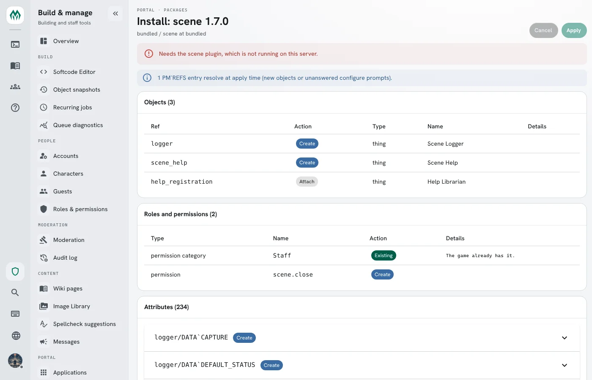
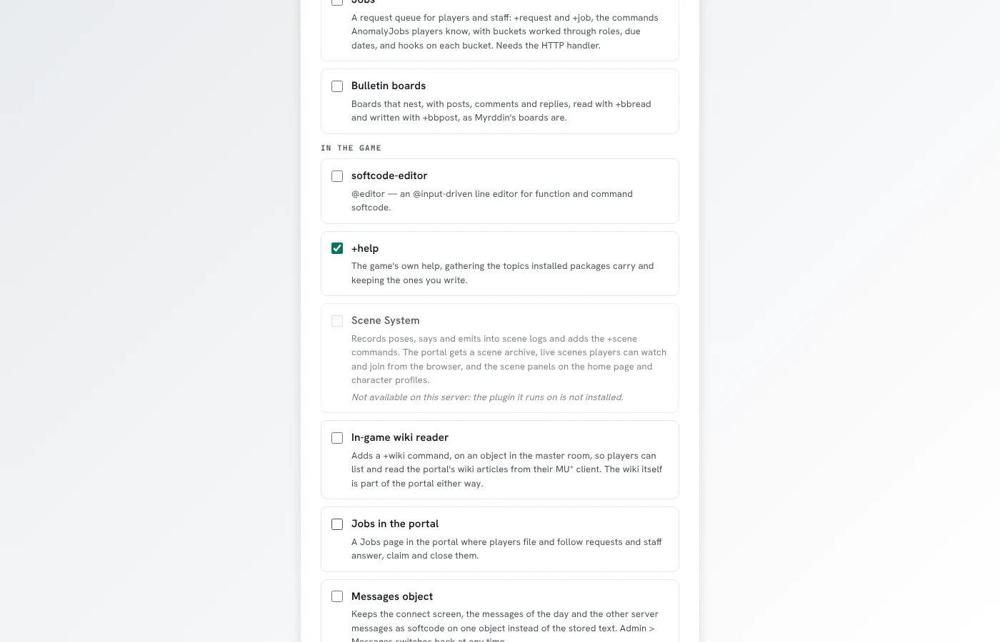

These are the `package.yaml` blocks a softcode package uses beside its `objects:`, each with the
format version that added it. [Package Format](/reference/package-format) covers the rest of the
manifest and lists every version.

## Roles and permissions (format 1.2)

A package can bring the roles and custom permissions its softcode checks, and the categories they
belong to. Declare them beside `objects:` and set `format: 1.2`; an older server warns and ignores
these blocks.

```yaml
format: 1.2
package: requests
version: 1.0.0

objects:
  - ref: requests
    type: thing
    name: Requests

categories:                     # each list optional; every category needs a description
  roles:
    - name: Requests
      description: Roles for working the request queue.
  permissions:
    - name: Requests
      description: Permissions for the request queue.

permissions:                    # custom permissions only, checked with permission() or PERM^ locks
  - name: requests.handle
    category: Requests          # declared above, or already in the game
    description: Work on any request.

roles:
  - slug: handler               # what roles() lists and hasrole() takes
    name: Request Handler       # optional display name (defaults to the slug)
    category: Requests
    color: "#4fc3c8"            # optional
    priority: 11                # optional, 1-29: always below the wizard role
    permissions:                # custom permissions only: allow | deny
      requests.handle: allow
```

A role may allow or deny only custom permissions. Built-in ones (`wiki.admin`, `game.wizard` and so
on) are the game's to hand out with `@role`, so installing a package never grants staff powers. A
package can't declare a system role, and a plugin or UI package can't declare any of these blocks.

- **Install.** Anything the game doesn't have yet is created and belongs to the package. Anything the
  game already has (a `Staff` category, a `helper` role) is used as it is; the package never changes
  or removes it. A role or permission another installed package owns stops the install, as does a
  role naming a category or permission that neither the package nor the game has.
- **Upgrade.** Each item is compared field by field with what the previous version declared: a field
  the new version changes takes the new value, and every other field keeps what the game has. So
  renaming the package's role, or denying one of its permissions on it, survives an upgrade that
  doesn't touch that field.
- **Removed items and uninstall.** A role nobody holds, a permission no remaining role uses, and an
  empty category are removed. Anything the game still relies on (a role someone holds, a permission a
  role still uses, a category with something in it) is kept and stops belonging to the package, so a
  later reinstall treats it as the game's own. Removing a permission also clears every account and
  object override of it.
- **Rollback** restores objects and attributes only; roles, permissions and categories stay as they
  are.

## Configuration options (format 1.3)

A package can set configuration options, the same ones `@config/set` sets. Declare them under
`settings:` and set `format: 1.3`; an older server warns and ignores the block.

```yaml
format: 1.3
package: messages
version: 1.0.0

objects:
  - ref: messages
    type: thing
    name: Messages

settings:                       # the option name as @config lists it: its value
  messages_object: "{{messages}}"   # a dbref option may name one object ref
  noisy_whisper: "yes"          # otherwise, a value @config/set would accept
```

The option must exist and be one `@config/set` can change (not a file path, a list with its own
command, or one of God's options), and a value must be one the option accepts; otherwise the
manifest is refused. A ref is only allowed for a dbref option, and must be the whole value. When the
package is planned, each value is also checked against the live game: a value out of range, or one
the game refuses, stops the plan instead of being adjusted. A plugin or UI package can't declare
`settings:`.

The review screen lists each option with its current and new value, and asks for confirmation before
applying a package that changes one.

- **Install.** Each option is set, and the value it replaced is recorded. An option another installed
  package sets stops the install: uninstall that package first.
- **Upgrade.** A value the new version changes is set again. A value it leaves alone keeps whatever
  the game has now, so an administrator's `@config/set` survives.
- **Removed options and uninstall.** The option goes back to the value the package replaced, unless
  the game has changed it since; then it is left alone.
- **Rollback** leaves configuration options as they are.

## Wiki pages (format 1.4)

A package can ship wiki pages. Declare them under `wiki:` and set `format: 1.4`; an older server
warns and ignores the block. A package whose `wiki:` is all it has, a **content pack** such as a
rules reference or a setting primer, may leave out `objects:`. The `coast-guide` example in the
SharpMUSH Guide repository (`Examples/Packages/coast-guide/`) is one.

```yaml
format: 1.4
package: coast-guide
version: 1.0.0
locale: en                      # the pages' language; default the game's wiki default locale

wiki:
  - page: main:coast_road       # required: namespace:slug, the page's identity
    title: Coast Road           # required
    categories: [Travel]        # optional: category names
    file: wiki/coast-road.md    # the body: a file inside the package directory...
  - page: category:travel
    title: Travel
    pin: true                   # category pages only: pin the category to the wiki home
    file: wiki/category/travel.md
  - page: main:smugglers
    title: Smugglers
    published: true             # optional, default true; false ships a draft
    requires:                   # optional: what the page itself requires, per action
      view: [coast.gm]          # view | edit | delete
      edit: [wiki.admin]
    markdown: |                 # ...or inline Markdown; exactly one of file and markdown
      # Smugglers
      The smugglers use the sea caves below the [[Coast Road|main:coast_road]].
```

- **`page`** is `namespace:slug`, such as `main:blinded` or `category:conditions`. The namespace is
  `main`, `help` or `category`, in lower case. Biographies (`character`) and engine pages (`system`)
  are the game's, and a package can't ship them. The slug is lowercase, with `_` for a space and no
  `/`, `#`, `?` or `:`. Changing either part makes a new page and drops the old one, and a page may
  be listed once. A category page's slug is the category's key: `category:lowered_abilities` is the
  page of the category `Lowered Abilities`.
- **Links name pages in full.** Every wiki link in a page's text is `[[Display|namespace:slug]]`. A
  bare `[[Blinded]]`, or a title such as `[[Help:ORC License Notice]]`, is an error naming the file and
  the link. A link to a page outside the package is fine; one that looks like a typo for a page the
  package ships is a warning.
- **`file`** is a path relative to the package directory, with `/` between folders and no `..`. It
  is UTF-8 text of at most 1 MB, read once when the package is planned, so the review screen and the
  install see the same text.
- **Page text is literal Markdown.** `{{ref}}` tokens are not substituted in it, and softcode does
  not read it.
- **`requires`** names, per action, the permissions a reader needs on top of the wiki's own rules:
  a built-in one (`wiki.admin`) or a custom one, declared in the same manifest's `permissions:` or
  already in the game.
- **`locale`** is the language the pages are written in.

A plugin or UI package can't declare `wiki:`. Pages are written as the Package Manager wizard, and
the review screen lists every page with what the install does to it.

- **Install.** A page the game doesn't have is created. A page the game already has exactly as the
  package ships it is adopted without a write. A page the game has otherwise is a conflict: **Keep
  mine** (the default) leaves the game's page alone, and **Take theirs** writes the package's page over
  it. A page another installed package owns stops the plan.
- **Upgrade.** Each page merges three ways, as attributes do: the body line by line, the title and
  the published flag as values, and categories, requirements and the pin as sets, so a category
  staff added stays. When both sides changed the same passage, the review screen shows the clash. A
  page staff deleted stays deleted unless the new version changed it, which is a conflict.
- **Dropped pages and uninstall.** A page nobody changed is deleted, and its category is unpinned
  if the package pinned it. A page staff changed stays as the game's page.
- **Rollback** leaves wiki pages as they are; a page's own history is the way back for its text.

## Attribute entries (format 1.5)

A package can add standard attributes to the game's attribute table, the one `@attribute` manages:
the flags every new copy of an attribute gets, and a `limit` or an `enum` its values must meet.
Declare them under `attributes:` and set `format: 1.5`; an older server warns and ignores the block.

```yaml
format: 1.5
package: jobs
version: 2.0.0

attributes:                     # attribute name: the entry @attribute would make
  JOB`STATUS:
    enum: [new, staff, player, held, closed]   # as @attribute/enum: a value must be one of these
  JOB`TITLE:
    limit: '^.{1,60}$'          # as @attribute/limit: a regular expression, any case
  JOB`DUE:
    enum: [this week, next week, someday]
    delimiter: '|'              # choices with spaces need another delimiter
  JOB`NOTES:
    flags: [wizard, no_command] # default flags, as @attribute/access takes them
    retroactive: true           # also give these flags to every copy already on an object
```

A name is written as `@attribute` takes it, with `` ` `` only between branches. Each flag must be an
attribute flag (`help attribute flags` lists them; `branch` can't be a default). An entry takes a `limit` or an
`enum`, not both, because each replaces the other. A plugin or UI package can't declare `attributes:`.

After installing `jobs` above, `` @attribute JOB`STATUS `` shows the entry:

```
@attribute: Information for 'JOB`STATUS'
  Default flags: none
  Enum values: new staff player held closed
```

Output: the entry's name, its default flags (none here) and the values it accepts. Setting another
value is refused:

```
&JOB`STATUS me=bogus
```

Output: `` Value for JOB`STATUS needs to be one of: new staff player held closed ``.

The review screen lists each entry with what the apply does to it, and how many existing copies a
`retroactive` entry changes.


- **Install.** An entry the game doesn't have is created and becomes the package's. An entry the game
  already has is the game's: the package uses it as it is and never changes or removes it. If its
  `limit` or `enum` differs from the manifest's, the install stops and says why; different default
  flags are only noted. An entry another installed package owns stops the install.
- **Retroactive.** Default flags reach new copies of the attribute only. With `retroactive: true`,
  every copy already on an object gets exactly the entry's flags too, whenever the apply writes them
  or a new version turns `retroactive` on; owners are left alone. The review screen shows how many copies change and asks for confirmation
  before applying.
- **Upgrade.** A field the new version changes (the flags, or the limit or enum) takes the new value.
  A field it leaves alone keeps whatever the game has now, so an administrator's `@attribute/access`
  survives.
- **Removed entries and uninstall.** The entry is deleted from the table. Values already stored on
  objects stay as they are.
- **Rollback** leaves attribute entries as they are.

## Engine version range (format 1.6)

Three keys say which SharpMUSH versions a package runs on. `verified_server` and `maximum_server`
need `format: 1.6`; an older server warns and ignores them.

```yaml
format: 1.6
requires_server: ">=2.0"    # the lowest version, with >= or >
verified_server: "2.4"      # the newest version the author tested on
maximum_server: "2"         # the newest version it runs on: every 2.x
```

| Key | Written as | On a server outside it |
|---|---|---|
| `requires_server` | `>=` or `>` clauses | Refused: the review screen shows why and **Apply** stays off |
| `verified_server` | a version | A newer *major* version warns; the install goes ahead |
| `maximum_server` | one to three numbers | Warns, and **Apply** waits for **Install it anyway** |

In `maximum_server`, the numbers left out match anything: `2` is every 2.x, `2.4` every 2.4.x,
`2.4.1` that version alone. A package installed past its maximum is marked **Past maximum** on the
Packages page, and the audit log records `package.past-maximum`. Installing a version that fits the
server clears the mark.

Leave `maximum_server` out unless a SharpMUSH version is known to break the package.
[Versioning Packages](/guides/versioning) explains why, and what counts as a breaking change.

## Plugins a package calls (format 1.7)

Some commands and functions come from a [plugin](/guides/plugins), not from the engine: `@scene`,
`scenewhere()` and the other `scene…()` functions are the Scene plugin's. A plugin can be turned off,
fail to load, or not be installed at all, and then those names are not there. A package whose code
calls them names the plugins under `plugins:`, by plugin id (the `id` in its `plugin.json`):

```yaml
format: 1.7
package: scene-verse
version: 1.1.0
plugins: [scene]

depends:
  - scene: ">=1.6"
```

- **Install and upgrade.** The plan is blocked while any plugin it names is not running. The review
  screen and `@package` say which one: `needs the scene plugin, which is not running`.
- **Turning a plugin off** (the Plugins tab or `@plugin/disable`) uninstalls, after a backup and your
  confirmation, every package that names it, and the packages that depend on those.
- **Rollback.** Rolling a package back puts back the plugins that revision named. A rollback to a
  revision whose plugin is not running is refused: `revision 1 needs the scene plugin, which is not running`.
- **The bundled catalogue** does not offer a package whose plugin is not running, and a new game does
  not install it.





Name a plugin here only when the package cannot work without it. Code that only reads a plugin when it
is there, and checks first, needs no entry. The bundled `room-contents` package does this: it asks
`scenewhere()` for the room's scene and treats any `#-1` answer, including the one for a function that
does not exist, as no scene.

## Attribute indexes (format 1.8)

An attribute entry can carry an `index:`, so the package's code can find objects by the attribute's
value with `indexed()` or `lsearch()`'s `INDEX` class instead of searching every object.
[Attribute Indexes](/guides/attribute-indexes) explains what an index does. Set `format: 1.8`; in an
older manifest `index:` is ignored with a warning.

```yaml
format: 1.8
package: casebook
version: 1.0.0

attributes:
  CASE`STATUS:
    enum: [open, held, closed]
    index: true                 # text without case, whole values, every object
  CASE`LEVEL:
    index: numeric type:thing   # the option words, as @attribute/index takes them
  CASE`TAGS:
    index: [exact, "split:|"]   # or the same words as a list
```

`index: false` is the same as no `index:`. The options are `exact`, `numeric`, `split` or
`split:<delimiter>`, and `type:<type>`.


- **Install.** The review screen says how many objects each index builds over. The index is built in
  the background after the apply; until it is ready, `indexed()` answers `#-1 INDEX BUILDING`. If the
  game already has the attribute, it must already have the same index, or the install stops and names
  the `@attribute/index` line that fixes it.
- **Upgrade.** The index is merged like the entry's other fields: a version that changes `index:`
  changes the index, and one that leaves it alone keeps whatever the game has now.
- **Removed entries and uninstall.** The entry is deleted with its index.

## Attribute watches (format 1.9)

An attribute entry can carry a `watch:`, as `@attribute/watch` sets one: whenever a copy of the
attribute on any object is set, cleared or wiped, the event handler runs its attributes matching
the pattern, with the object, the attribute, the old and new values and the enactor as `%0`-`%4`.
Set `format: 1.9`; in an older manifest `watch:` is ignored with a warning.

```yaml
format: 1.9
attributes:
  HP:
    watch: true
```

`watch: true` is the default pattern, `` WATCH`<name> WATCH`<name>`* ``, so the package's handler is an
attribute such as `` WATCH`HP`<package> `` on the event handler. Otherwise give the pattern as a string
of space-separated attribute wildcards, or as a list. `false` is the same as no `watch:`.

- **Install.** If the game already has the attribute, it must already have the same watch, or the
  plan stops and names the `@attribute/watch` line that fixes it.
- **Upgrade.** The watch is merged like the entry's other fields.
- **Removed entries and uninstall.** The entry is deleted with its watch.

## Category (format 1.10)

`category:` names the group a package belongs with, in the words people read. The setup wizard lists
the bundled packages under their categories, so a game picks its scene packages together and its staff
tools together. Set `format: "1.10"`, quoted so that YAML tools do not read it as 1.1. In an older
manifest `category:` is ignored with a warning.

```yaml
format: "1.10"
package: jobs-app
version: 1.0.3
category: Staff
```

`category:` is optional. A category is one name of up to 40 characters, and runs of spaces in it
become one. Packages that share a category, ignoring case, are listed together, and one with no
category is listed under **Uncategorized**, last. Within a category, a package that needs another package of the same category is
listed under it: `jobs-app` comes under `jobs`.


The categories the bundled packages use are listed in
[Softcode Packages](/guides/packages#the-bundled-catalogue).
